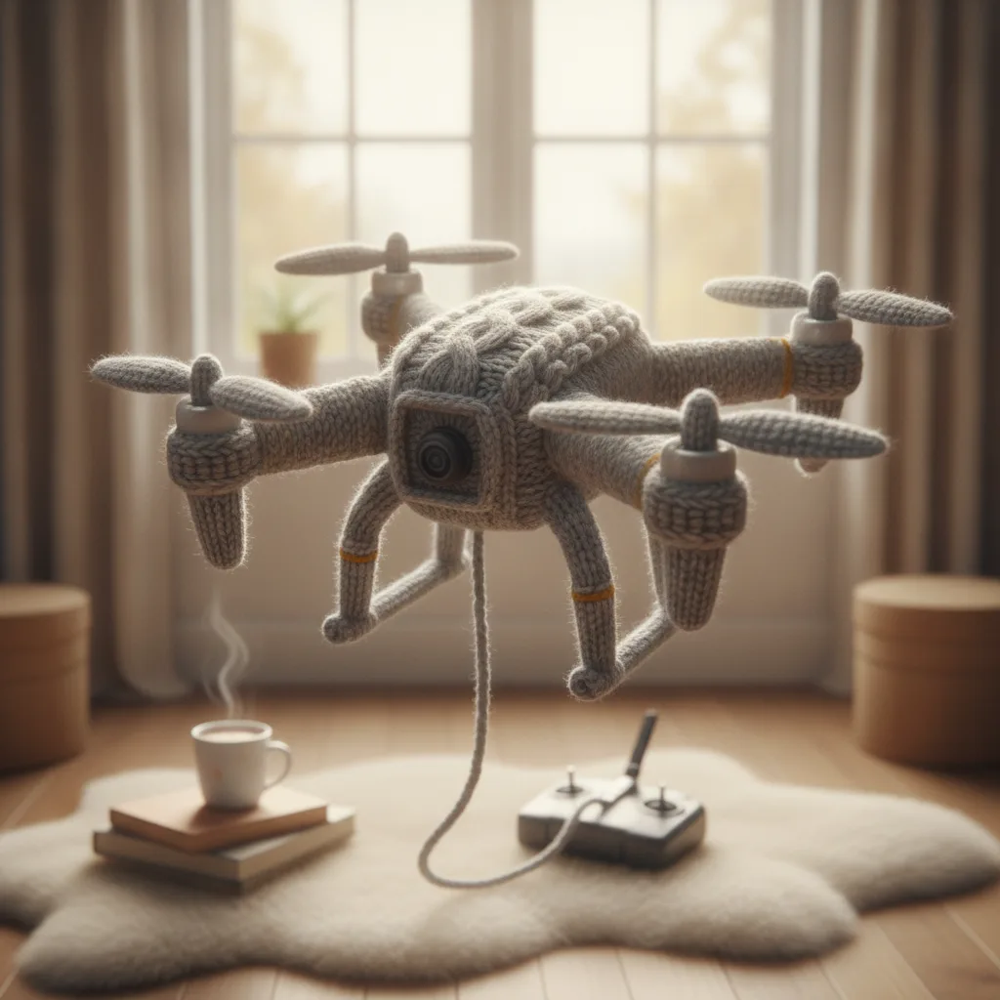

# OBJECT rendered as if entirely hand-knitted from chunky wool

[← Back to the collection](../../README.md) · Category: [Illustration & 3D](../../gallery/illustration-3d.md) · Model: `Vinano Image` · ID: `vn-00439`

<a href="https://vinano.ai?utm_source=github&utm_medium=readme&utm_campaign=awesome-image-video-prompts-updating&utm_content=prompt-page-image"></a>

<sub>Preview generated with <a href="https://vinano.ai?utm_source=github&utm_medium=readme&utm_campaign=awesome-image-video-prompts-updating&utm_content=prompt-page-caption">vinano.ai</a></sub>

## Prompt

```text
An [OBJECT] rendered as if entirely hand-knitted from chunky wool yarn, impossibly functional-looking despite being soft craft. Visible stitches, cable knit patterns on grip areas, ribbing where flexibility is needed, yarn ends neatly tucked. Positioned against a cozy lifestyle backdrop or clean wool-texture studio. Scandinavian hygge meets industrial design. Warm soft, diffused lighting emphasizing the yarn texture, the handmade quality, the absurd coziness of machinery. Sharp focus on stitch detail, warm saturated fiber colors, lifestyle product aesthetic, ultra-high resolution, the hard made soft. Maintain consistent colour harmony and crisp focus across the whole frame.
```

## Try it on vinano.ai

1. Copy the prompt above.
2. Open **[vinano.ai](https://vinano.ai?utm_source=github&utm_medium=readme&utm_campaign=awesome-image-video-prompts-updating&utm_content=prompt-page-try)**, paste it into the image generator and pick a model.
3. Swap any placeholders (brand, product, city, person…) for your own details, then generate.

More prompts like this: [Illustration & 3D gallery](../../gallery/illustration-3d.md) · [all categories](../../README.md#contents)
