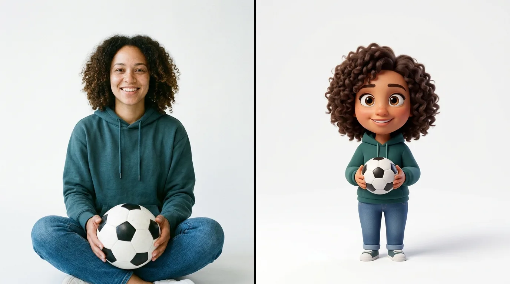

# Split composition portrait

[← Back to the collection](../../README.md) · Category: [Illustration & 3D](../../gallery/illustration-3d.md) · Model: `Vinano Image Pro` · ID: `vn-00441`

<a href="https://vinano.ai?utm_source=github&utm_medium=readme&utm_campaign=awesome-image-video-prompts-updating&utm_content=prompt-page-image"></a>

<sub>Preview generated with <a href="https://vinano.ai?utm_source=github&utm_medium=readme&utm_campaign=awesome-image-video-prompts-updating&utm_content=prompt-page-caption">vinano.ai</a></sub>

## Prompt

```text
Split composition portrait. PRIMARY SUBJECT (The Real Human - STRICT LIKENESS): On the left, a raw, hyper-realistic photograph of the person from the reference image. CRITICAL: The AI must preserve the exact facial geometry, bone structure, specific imperfections, and skin texture of the source image. Do not beautify or alter the face. This is a documentary-style portrait of the specific individual provided. The subject is wearing the outfit from the visual reference. Pose: Sitting cross-legged on the floor, facing forward, an authentic smile. SECONDARY SUBJECT (The Miniature): On the right, a tiny, cute 3D Pixar-style animated character, standing or sitting next to the human. This character is a stylized caricature of the human, wearing a matching miniature outfit. SETTING: Seamless pure white studio background. Soft filmic, cinematic lighting. 8k resolution, uncropped. --iw 2 make them both hold a soccer ball Keep edges clean and the overall composition balanced for a polished, gallery-ready result.
```

## Try it on vinano.ai

1. Copy the prompt above.
2. Open **[vinano.ai](https://vinano.ai?utm_source=github&utm_medium=readme&utm_campaign=awesome-image-video-prompts-updating&utm_content=prompt-page-try)**, paste it into the image generator and pick a model.
3. Swap any placeholders (brand, product, city, person…) for your own details, then generate.

More prompts like this: [Illustration & 3D gallery](../../gallery/illustration-3d.md) · [all categories](../../README.md#contents)
