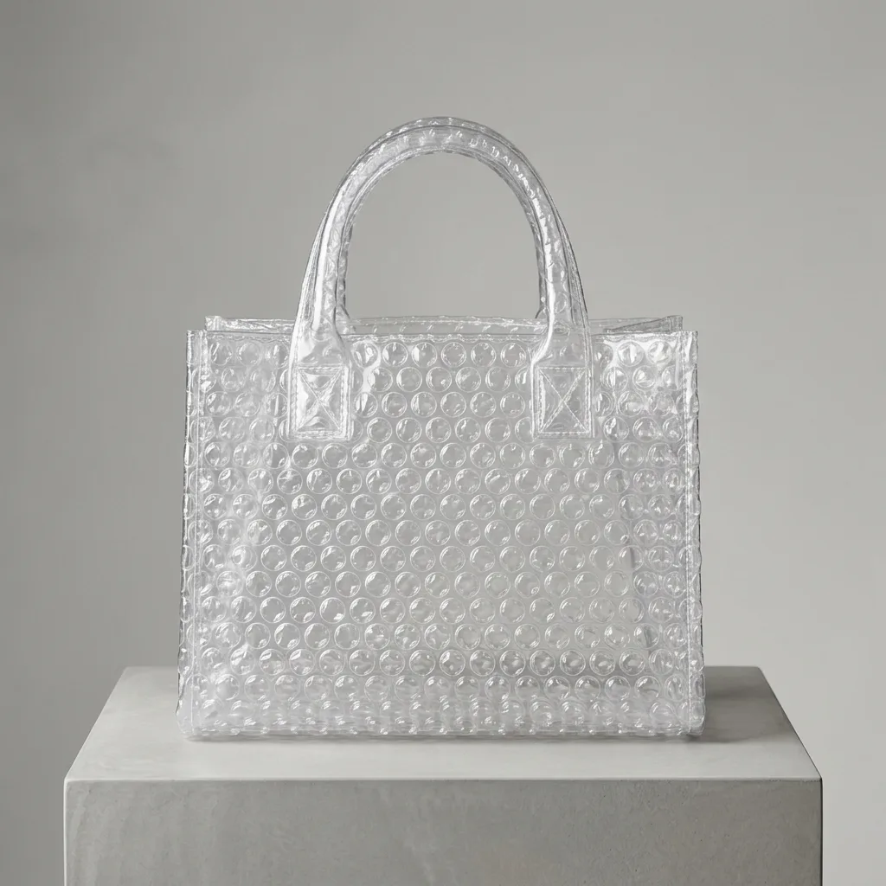

# Studio shot of a transparent bubble wrap fashion elegant

[← Back to the collection](../../README.md) · Category: [Illustration & 3D](../../gallery/illustration-3d.md) · Model: `Vinano Image v2` · ID: `vn-00443`

<a href="https://vinano.ai?utm_source=github&utm_medium=readme&utm_campaign=awesome-image-video-prompts-updating&utm_content=prompt-page-image"></a>

<sub>Preview generated with <a href="https://vinano.ai?utm_source=github&utm_medium=readme&utm_campaign=awesome-image-video-prompts-updating&utm_content=prompt-page-caption">vinano.ai</a></sub>

## Prompt

```text
{
 "prompt": "A studio shot of a transparent bubble wrap fashion elegant [ITEM], empty nothing inside. The material is clear, glossy, and highly detailed, capturing the texture of inflated bubbles. refined minimalist composition, high-fashion editorial style, soft diffused studio lighting, neutral background, ultra-clean aesthetic, true-to-life photorealistic rendering, sharp focus.",
 "style": {
 "lighting": "soft diffused studio lighting",
 "background": "neutral seamless backdrop",
 "mood": "modern, refined minimalist, elegant",
 "quality": "ultra-detailed, true-to-life photorealistic",
 "material": "transparent bubble wrap"
 }
}

Maintain consistent colour harmony and crisp focus across the whole frame.
```

## Try it on vinano.ai

1. Copy the prompt above.
2. Open **[vinano.ai](https://vinano.ai?utm_source=github&utm_medium=readme&utm_campaign=awesome-image-video-prompts-updating&utm_content=prompt-page-try)**, paste it into the image generator and pick a model.
3. Swap any placeholders (brand, product, city, person…) for your own details, then generate.

More prompts like this: [Illustration & 3D gallery](../../gallery/illustration-3d.md) · [all categories](../../README.md#contents)
