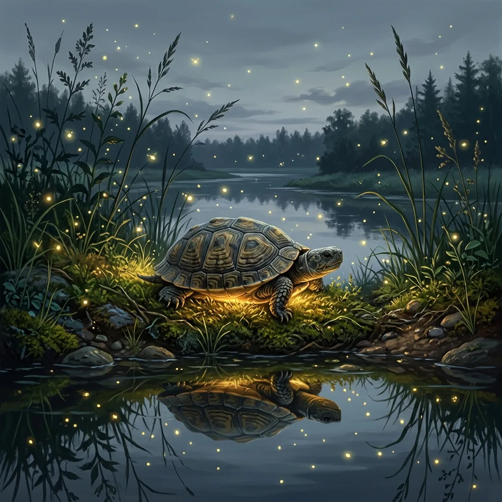

# Digital fantasy illustration of a small turtle resting

[← Back to the collection](../../README.md) · Category: [Illustration & 3D](../../gallery/illustration-3d.md) · Model: `Vinano Image v2` · ID: `vn-00449`

<a href="https://vinano.ai?utm_source=github&utm_medium=readme&utm_campaign=awesome-image-video-prompts-updating&utm_content=prompt-page-image"></a>

<sub>Preview generated with <a href="https://vinano.ai?utm_source=github&utm_medium=readme&utm_campaign=awesome-image-video-prompts-updating&utm_content=prompt-page-caption">vinano.ai</a></sub>

## Prompt

```text
A digital fantasy illustration of a small turtle resting on a grassy riverbank at twilight. The turtle has a detailed, textured shell a soft, warm golden glow emanating from underneath its body, casting light onto the surrounding mossy earth. The scene is filled magical, floating fireflies or glowing pollen particles that sparkle in the dim, atmospheric light. The turtle's reflection is clearly visible in the calm, still water below. Tall, slender blades of grass rise beside the turtle, silhouetted against a serene, muted gray-blue background. The overall mood is peaceful, ethereal, and cinematic, high detail and soft, dreamlike lighting. Maintain consistent colour harmony and crisp focus across the whole frame.
```

## Try it on vinano.ai

1. Copy the prompt above.
2. Open **[vinano.ai](https://vinano.ai?utm_source=github&utm_medium=readme&utm_campaign=awesome-image-video-prompts-updating&utm_content=prompt-page-try)**, paste it into the image generator and pick a model.
3. Swap any placeholders (brand, product, city, person…) for your own details, then generate.

More prompts like this: [Illustration & 3D gallery](../../gallery/illustration-3d.md) · [all categories](../../README.md#contents)
