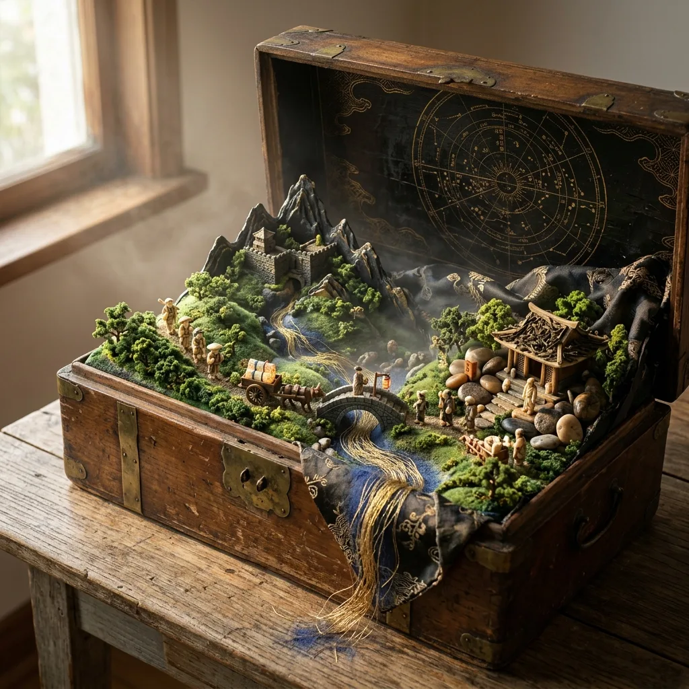

# AGE / ERA CONTAINER / OBJECT associated CULTURE /

[← Back to the collection](../../README.md) · Category: [Illustration & 3D](../../gallery/illustration-3d.md) · Model: `Vinano Image v2` · ID: `vn-00452`

<a href="https://vinano.ai?utm_source=github&utm_medium=readme&utm_campaign=awesome-image-video-prompts-updating&utm_content=prompt-page-image"></a>

<sub>Preview generated with <a href="https://vinano.ai?utm_source=github&utm_medium=readme&utm_campaign=awesome-image-video-prompts-updating&utm_content=prompt-page-caption">vinano.ai</a></sub>

## Prompt

```text
A [AGE / ERA] [CONTAINER / OBJECT] associated [CULTURE / CONTEXT], partially opened to reveal its contents transforming into a living landscape.
The material inside unfolds as a miniature world: [MATERIAL 1] becomes [GEOGRAPHIC FEATURE], [MATERIAL 2] forms [TERRAIN / STRUCTURE], [FINE DETAILS] flow like [NATURAL ELEMENTS].
Tiny [FIGURES / ENTITIES] inhabit the scene, moving through the terrain as part of a [JOURNEY / SYSTEM / ACTIVITY]. [CREATURES / VEHICLES] carry [SYMBOLIC LOADS] across [LANDMARKS].
A [SHELTER / HUB / ARCHITECTURE] constructed from [UNEXPECTED MATERIAL] serves as a gathering point. The interior surface of the object becomes a [SKY / MAP / COSMIC PATTERN] used for guidance or meaning.
The entire scene is unified by [ATMOSPHERIC ELEMENT] and [TEXTURAL DETAIL], evoking [ABSTRACT THEME / EMOTION].
Cinematic macro perspective, handcrafted realism, surreal scale contrast, warm directional lighting, tactile materials, poetic world-building.

Emphasise material texture and natural light so the final frame feels tactile and premium.
```

## Try it on vinano.ai

1. Copy the prompt above.
2. Open **[vinano.ai](https://vinano.ai?utm_source=github&utm_medium=readme&utm_campaign=awesome-image-video-prompts-updating&utm_content=prompt-page-try)**, paste it into the image generator and pick a model.
3. Swap any placeholders (brand, product, city, person…) for your own details, then generate.

More prompts like this: [Illustration & 3D gallery](../../gallery/illustration-3d.md) · [all categories](../../README.md#contents)
