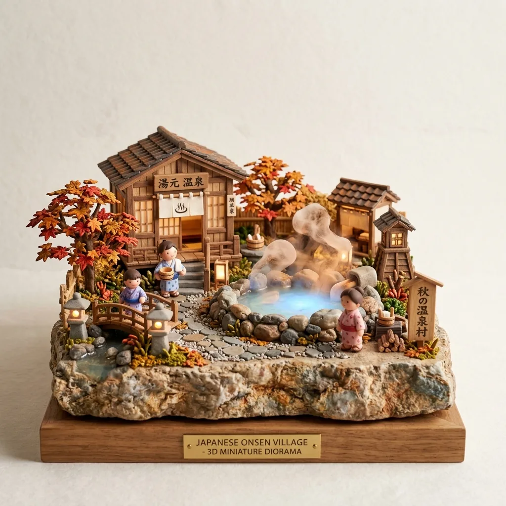

# 3D miniature scene, a JAPANESE ONSEN VILLAGE wooden bathhouses

[← Back to the collection](../../README.md) · Category: [Illustration & 3D](../../gallery/illustration-3d.md) · Model: `Vinano Image Pro` · ID: `vn-00454`

<a href="https://vinano.ai?utm_source=github&utm_medium=readme&utm_campaign=awesome-image-video-prompts-updating&utm_content=prompt-page-image"></a>

<sub>Preview generated with <a href="https://vinano.ai?utm_source=github&utm_medium=readme&utm_campaign=awesome-image-video-prompts-updating&utm_content=prompt-page-caption">vinano.ai</a></sub>

## Prompt

```text
3D miniature scene, a [JAPANESE ONSEN VILLAGE] [wooden bathhouses, steam rising from natural hot springs, stone lanterns, maple trees in autumn color, guests in tiny yukata robes carrying wooden buckets], presented as a small platform diorama. The platform is carved from natural hot spring rock mineral deposits. Side view, cute clay style, miniature diorama, soft rendered lighting effects, warm steam diffusing the light, light background. Aim for an editorial, design-driven look with deliberate negative space.
```

## Try it on vinano.ai

1. Copy the prompt above.
2. Open **[vinano.ai](https://vinano.ai?utm_source=github&utm_medium=readme&utm_campaign=awesome-image-video-prompts-updating&utm_content=prompt-page-try)**, paste it into the image generator and pick a model.
3. Swap any placeholders (brand, product, city, person…) for your own details, then generate.

More prompts like this: [Illustration & 3D gallery](../../gallery/illustration-3d.md) · [all categories](../../README.md#contents)
