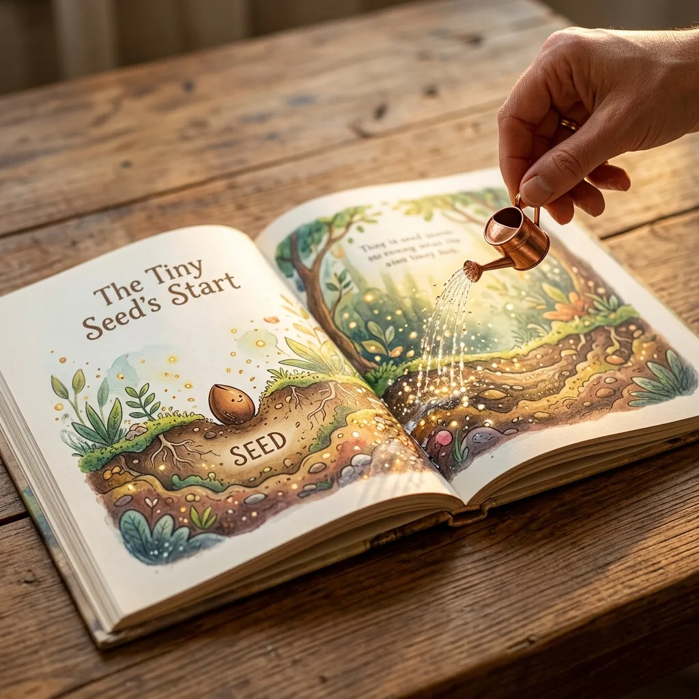

# Open children’s picture book rests on a wooden table

[← Back to the collection](../../README.md) · Category: [Illustration & 3D](../../gallery/illustration-3d.md) · Model: `Vinano Image v2` · ID: `vn-00465`

<a href="https://vinano.ai?utm_source=github&utm_medium=readme&utm_campaign=awesome-image-video-prompts-updating&utm_content=prompt-page-image"></a>

<sub>Preview generated with <a href="https://vinano.ai?utm_source=github&utm_medium=readme&utm_campaign=awesome-image-video-prompts-updating&utm_content=prompt-page-caption">vinano.ai</a></sub>

## Prompt

```text
{
 "prompt": "An open children’s picture book rests on a wooden table, showing a whimsical illustration of a small brown seed in cartoon soil. A realistic human hand pours water from a tiny can, a sparkling stream. Warm golden light, magical mood, overhead close-up, true-to-life photorealistic, 4K.",
 "style": "true-to-life photorealistic",
 "lighting": "warm golden",
 "mood": "magical",
 "perspective": "overhead close-up",
 "resolution": "4K",
 "elements": [{
 "type": "book",
 "description": "children’s picture book open on wooden table"
 },
 {
 "type": "illustration",
 "description": "whimsical small brown seed in cartoon soil"
 },
 {
 "type": "hand",
 "description": "realistic human hand pouring water from tiny can"
 },
 {
 "type": "water",
 "description": "sparkling stream"
 }]
}

Aim for an editorial, design-driven look with deliberate negative space.
```

## Try it on vinano.ai

1. Copy the prompt above.
2. Open **[vinano.ai](https://vinano.ai?utm_source=github&utm_medium=readme&utm_campaign=awesome-image-video-prompts-updating&utm_content=prompt-page-try)**, paste it into the image generator and pick a model.
3. Swap any placeholders (brand, product, city, person…) for your own details, then generate.

More prompts like this: [Illustration & 3D gallery](../../gallery/illustration-3d.md) · [all categories](../../README.md#contents)
