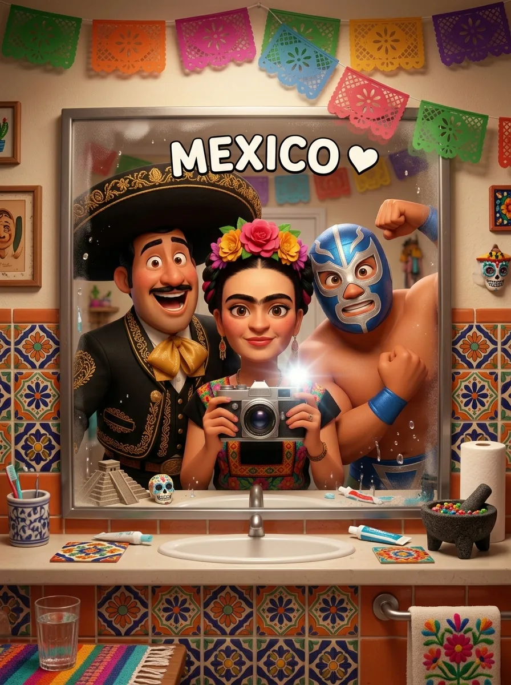

# Premium-quality stylized 3D CGI Pixar-style render, vertical 3:4 composition

[← Back to the collection](../../README.md) · Category: [Illustration & 3D](../../gallery/illustration-3d.md) · Model: `Vinano Image Pro` · ID: `vn-00469`

<a href="https://vinano.ai?utm_source=github&utm_medium=readme&utm_campaign=awesome-image-video-prompts-updating&utm_content=prompt-page-image"></a>

<sub>Preview generated with <a href="https://vinano.ai?utm_source=github&utm_medium=readme&utm_campaign=awesome-image-video-prompts-updating&utm_content=prompt-page-caption">vinano.ai</a></sub>

## Prompt

```text
premium-quality stylized 3D CGI Pixar-style render, vertical 3:4 composition, three most iconic and recognizable cultural figures from [COUNTRY] captured as a chaotic and joyful bathroom mirror selfie; the most visually striking figure holds the large vintage camera up toward the mirror in their most authentic traditional costume, the remaining figures squeezed tightly into the frame each wearing their most iconic outfit and showing their most signature expression or pose; everyone crammed together filling the entire mirror frame faces large and close to the camera, tightly packed no empty space, chaotic crowded energy; facial proportions gently stylized in Disney/Pixar animation style expressive eyes while faithfully preserving each character's most authentic cultural costume and recognizable traits; the bathroom mirror has realistic toothpaste splatters and water droplets; the reflection shows bold black Pixar-style lettering reading "[COUNTRY]❤️"; the bathroom background is styled to match the cultural identity of [COUNTRY] authentic thematic props, traditional decorations and iconic landmark easter eggs placed naturally around the scene; lighting combines soft ambient bathroom lighting a bright camera flash reflecting in the mirror; warm Pixar-style color grading, ultra-detailed 4K render, no watermark Keep edges clean and the overall composition balanced for a polished, gallery-ready result.
```

## Try it on vinano.ai

1. Copy the prompt above.
2. Open **[vinano.ai](https://vinano.ai?utm_source=github&utm_medium=readme&utm_campaign=awesome-image-video-prompts-updating&utm_content=prompt-page-try)**, paste it into the image generator and pick a model.
3. Swap any placeholders (brand, product, city, person…) for your own details, then generate.

More prompts like this: [Illustration & 3D gallery](../../gallery/illustration-3d.md) · [all categories](../../README.md#contents)
