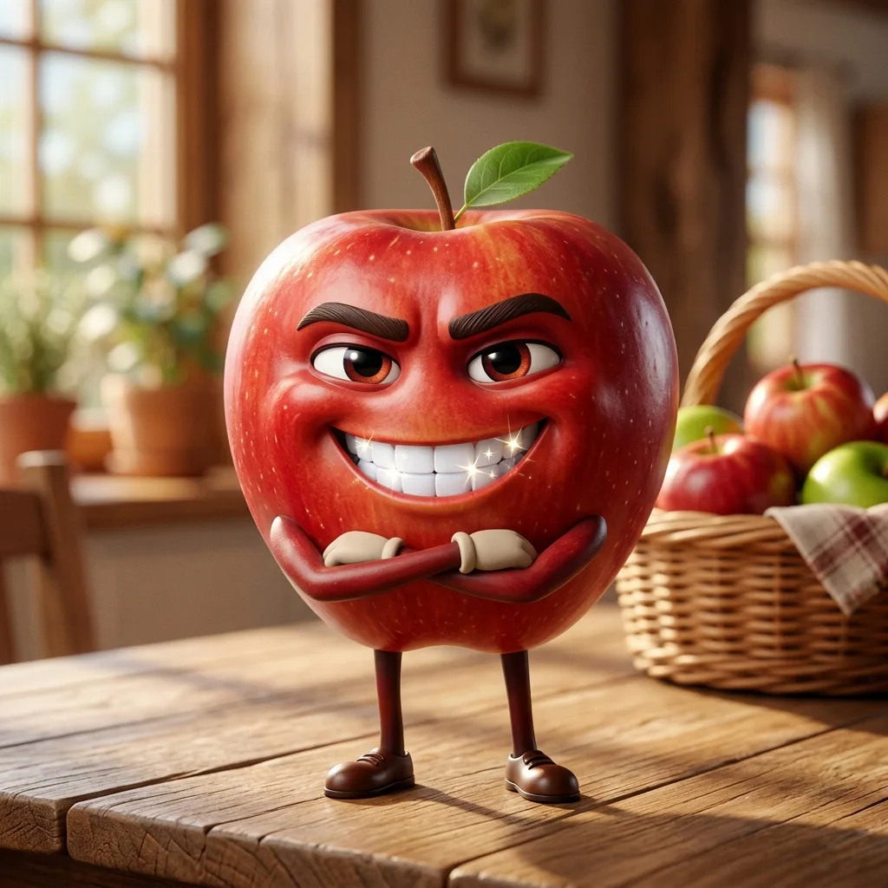

# Pixar-style 3D animated character of a single red apple

[← Back to the collection](../../README.md) · Category: [Illustration & 3D](../../gallery/illustration-3d.md) · Model: `Vinano Image v2` · ID: `vn-00480`

<a href="https://vinano.ai?utm_source=github&utm_medium=readme&utm_campaign=awesome-image-video-prompts-updating&utm_content=prompt-page-image"></a>

<sub>Preview generated with <a href="https://vinano.ai?utm_source=github&utm_medium=readme&utm_campaign=awesome-image-video-prompts-updating&utm_content=prompt-page-caption">vinano.ai</a></sub>

## Prompt

```text
A Pixar-style 3D animated character of a single red apple. Handsome male character sharp confident eyes, thick stylish eyebrows, and a wide charismatic grin showing bright white sparkling teeth. Smooth slightly glossy red skin texture subtle highlights and natural gradients. The apple has small cartoon arms and legs, standing upright arms crossed in a proud hero-like pose.

Teeth are shiny and perfectly white small sparkle effects. In the background, a basket of apples is slightly blurred. The character is standing on a wooden dining table near a sunny window in a cozy modern home. Vibrant colors, filmic, cinematic lighting, soft shadows, high-fidelity textures, ultra-detailed, 8k.

Render with rich micro-detail while keeping the layout uncluttered and intentional.
```

## Try it on vinano.ai

1. Copy the prompt above.
2. Open **[vinano.ai](https://vinano.ai?utm_source=github&utm_medium=readme&utm_campaign=awesome-image-video-prompts-updating&utm_content=prompt-page-try)**, paste it into the image generator and pick a model.
3. Swap any placeholders (brand, product, city, person…) for your own details, then generate.

More prompts like this: [Illustration & 3D gallery](../../gallery/illustration-3d.md) · [all categories](../../README.md#contents)
