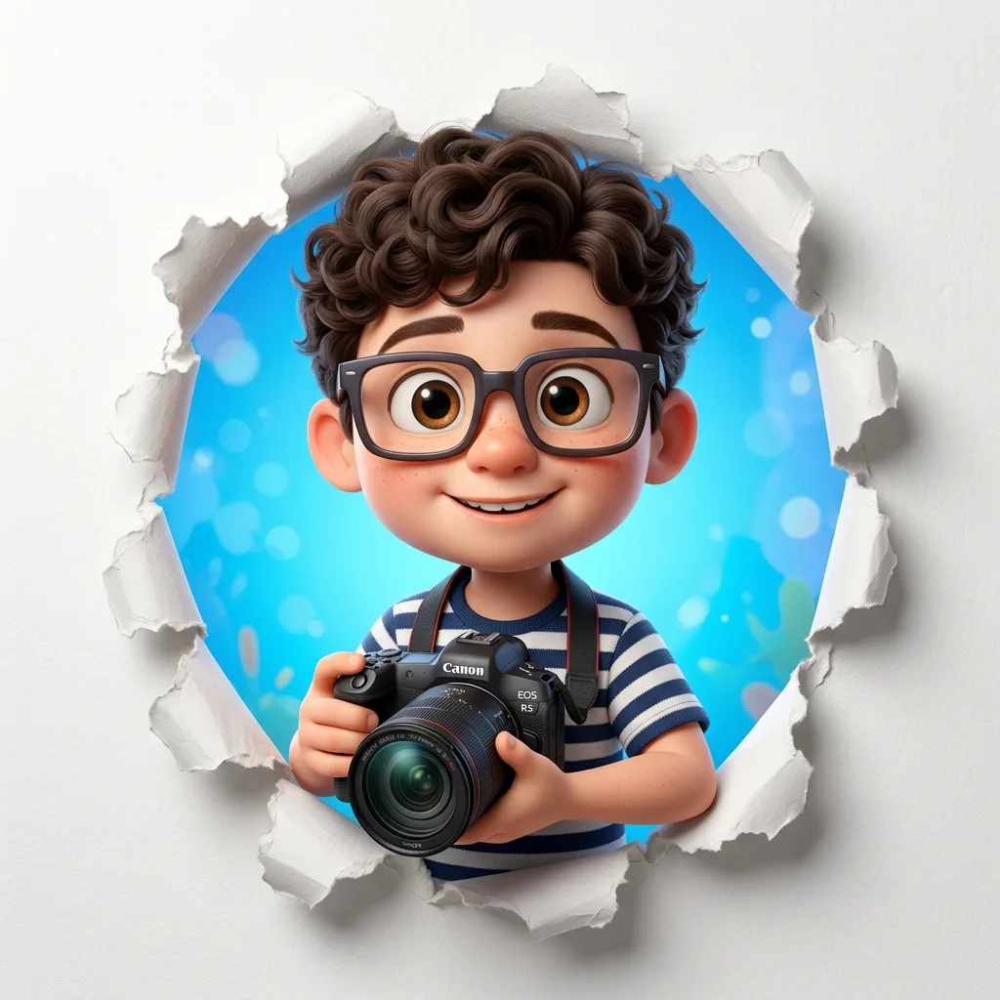

# Illustration & 3D prompt #481

[← Back to the collection](../../README.md) · Category: [Illustration & 3D](../../gallery/illustration-3d.md) · Model: `Vinano Image v2` · ID: `vn-00481`

<a href="https://vinano.ai?utm_source=github&utm_medium=readme&utm_campaign=awesome-image-video-prompts-updating&utm_content=prompt-page-image"></a>

<sub>Preview generated with <a href="https://vinano.ai?utm_source=github&utm_medium=readme&utm_campaign=awesome-image-video-prompts-updating&utm_content=prompt-page-caption">vinano.ai</a></sub>

## Prompt

```text
A cute stylized 3D cartoon character (boy/girl) big expressive eyes, soft smooth skin, and round facial features, wearing glasses and a casual striped t-shirt, holding a professional DSLR camera. The character is emerging through a torn paper hole in a clean white wall, realistic ripped paper edges and depth. Behind the hole is a bright blue gradient background, creating contrast. The character is smiling directly at the viewer, vibrant and friendly mood, Pixar-style rendering, ultra-detailed textures, soft studio lighting, high realism, 8K resolution. Maintain consistent colour harmony and crisp focus across the whole frame.
```

## Try it on vinano.ai

1. Copy the prompt above.
2. Open **[vinano.ai](https://vinano.ai?utm_source=github&utm_medium=readme&utm_campaign=awesome-image-video-prompts-updating&utm_content=prompt-page-try)**, paste it into the image generator and pick a model.
3. Swap any placeholders (brand, product, city, person…) for your own details, then generate.

More prompts like this: [Illustration & 3D gallery](../../gallery/illustration-3d.md) · [all categories](../../README.md#contents)
