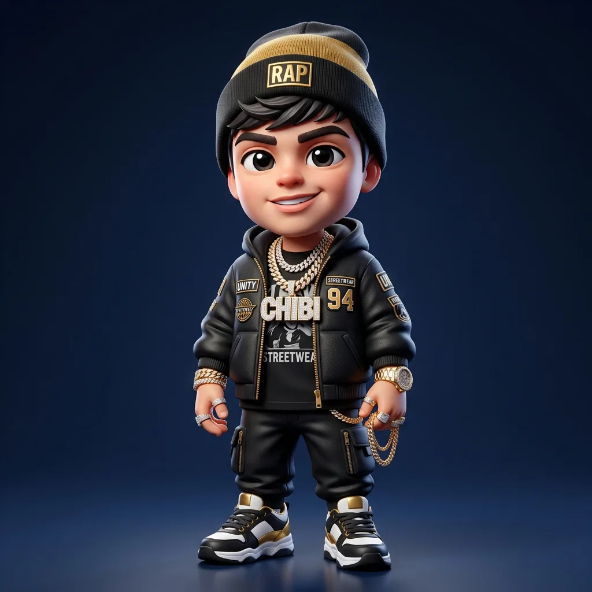

# Maintaining the facial features of all creatures… chibi styled

[← Back to the collection](../../README.md) · Category: [Illustration & 3D](../../gallery/illustration-3d.md) · Model: `Vinano Image v2` · ID: `vn-00487`

<a href="https://vinano.ai?utm_source=github&utm_medium=readme&utm_campaign=awesome-image-video-prompts-updating&utm_content=prompt-page-image"></a>

<sub>Preview generated with <a href="https://vinano.ai?utm_source=github&utm_medium=readme&utm_campaign=awesome-image-video-prompts-updating&utm_content=prompt-page-caption">vinano.ai</a></sub>

## Prompt

```text
Maintaining the facial features of all creatures…
chibi styled 3d, wearing rapper outfit style, babyoversized head and small body (chibi proportions), preserving the person’s recognizable facial features and likeness. Stylized
realistic but cartoonish, smooth textures, expressive face, big eyes. Full-body character wearing typical streetwear clothing and accessories, including diamond chains. premium-quality 3D lighting, vibrant colors, playful proportions, style. Clean DARK BLUE background, studio lighting, sharp focus.

Keep edges clean and the overall composition balanced for a polished, gallery-ready result.
```

## Try it on vinano.ai

1. Copy the prompt above.
2. Open **[vinano.ai](https://vinano.ai?utm_source=github&utm_medium=readme&utm_campaign=awesome-image-video-prompts-updating&utm_content=prompt-page-try)**, paste it into the image generator and pick a model.
3. Swap any placeholders (brand, product, city, person…) for your own details, then generate.

More prompts like this: [Illustration & 3D gallery](../../gallery/illustration-3d.md) · [all categories](../../README.md#contents)
