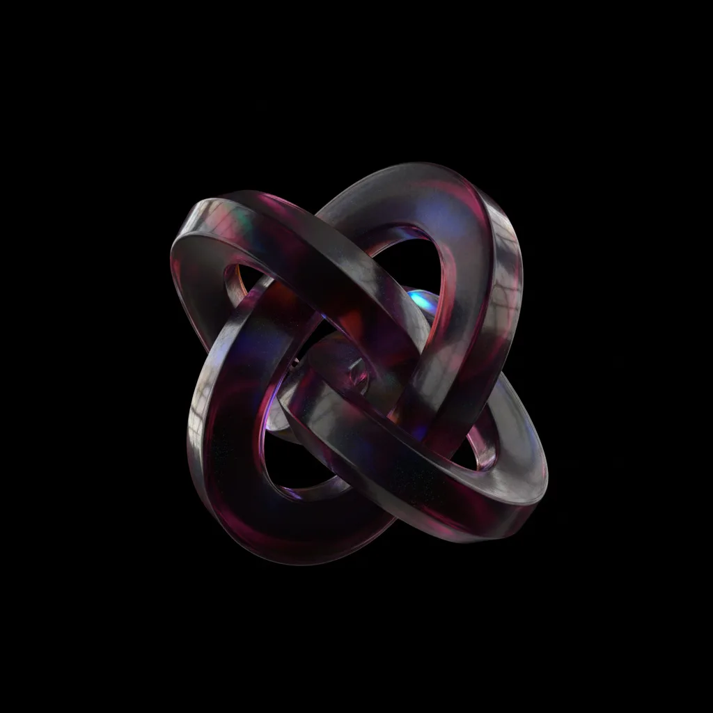

# Strictly centered and levitating

[← Back to the collection](../../README.md) · Category: [Illustration & 3D](../../gallery/illustration-3d.md) · Model: `Vinano Image` · ID: `vn-00495`

<a href="https://vinano.ai?utm_source=github&utm_medium=readme&utm_campaign=awesome-image-video-prompts-updating&utm_content=prompt-page-image"></a>

<sub>Preview generated with <a href="https://vinano.ai?utm_source=github&utm_medium=readme&utm_campaign=awesome-image-video-prompts-updating&utm_content=prompt-page-caption">vinano.ai</a></sub>

## Prompt

```text
{
 "ultra_high_fidelity_request": {
 "subject": "[PRODUCT]",
 "framing": {
 "position": "Strictly centered and levitating",
 "boundary": "Full product visibility, zero cropping, isolated in 3D space",
 "background": "Solid pure black hex #000000"
 },
 "optical_effects": {
 "iridescence": "Extremely brilliant spectral iridescence, vivid neon oil-slick gradients",
 "volumetric": "Internal volumetric lighting, ethereal inner glow, light scattering within the material",
 "refraction": "High-index caustic light refraction, prismatic color splitting at the edges",
 "luminosity": "Super-saturated holographic highlights, intense electric blues and deep magentas"
 },
 "material_finish": {
 "texture": "Ultra-glossy liquid-smooth finish",
 "base": "Deep translucent obsidian glass infinite depth",
 "reflections": "Crisp ray-traced mirror reflections of an invisible light source"
 },
 "negative_constraints": ["No platforms", "No floor", "No light boxes", "No softboxes",
 "No props", "No text", "No shadows on surfaces", "No pedestals"]
 }
}

Emphasise material texture and natural light so the final frame feels tactile and premium.
```

## Try it on vinano.ai

1. Copy the prompt above.
2. Open **[vinano.ai](https://vinano.ai?utm_source=github&utm_medium=readme&utm_campaign=awesome-image-video-prompts-updating&utm_content=prompt-page-try)**, paste it into the image generator and pick a model.
3. Swap any placeholders (brand, product, city, person…) for your own details, then generate.

More prompts like this: [Illustration & 3D gallery](../../gallery/illustration-3d.md) · [all categories](../../README.md#contents)
