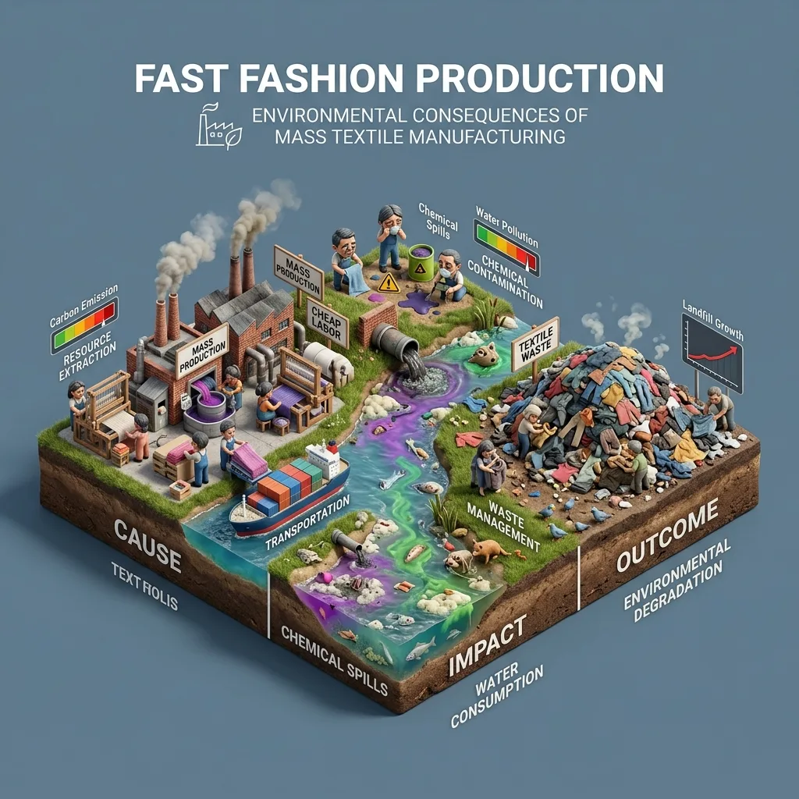

# “Build an isometric miniature 3D diorama explaining the environmental

[← Back to the collection](../../README.md) · Category: [Illustration & 3D](../../gallery/illustration-3d.md) · Model: `Vinano Image Pro` · ID: `vn-00501`

<a href="https://vinano.ai?utm_source=github&utm_medium=readme&utm_campaign=awesome-image-video-prompts-updating&utm_content=prompt-page-image"></a>

<sub>Preview generated with <a href="https://vinano.ai?utm_source=github&utm_medium=readme&utm_campaign=awesome-image-video-prompts-updating&utm_content=prompt-page-caption">vinano.ai</a></sub>

## Prompt

```text
“Build an isometric miniature 3D diorama explaining the environmental impact of [ACTIVITY OR PRODUCT].

Viewpoint stays near 45° from above.
Textures look realistic and balanced. Lighting feels soft and clear. The raised base splits into cause, impact, and outcome sections. Include visual indicators like meters, symbols, or levels.

Tiny stylized figures represent people, wildlife, or infrastructure. Figures have heavy facial details.

Background remains solid [BACKGROUND COLOR].
Top center text reads [TOPIC NAME] in bold.

Subtitle states the key impact in one line. A minimal environment icon appears below. Text switches between white or black for contrast.”

Render with rich micro-detail while keeping the layout uncluttered and intentional.
```

## Try it on vinano.ai

1. Copy the prompt above.
2. Open **[vinano.ai](https://vinano.ai?utm_source=github&utm_medium=readme&utm_campaign=awesome-image-video-prompts-updating&utm_content=prompt-page-try)**, paste it into the image generator and pick a model.
3. Swap any placeholders (brand, product, city, person…) for your own details, then generate.

More prompts like this: [Illustration & 3D gallery](../../gallery/illustration-3d.md) · [all categories](../../README.md#contents)
