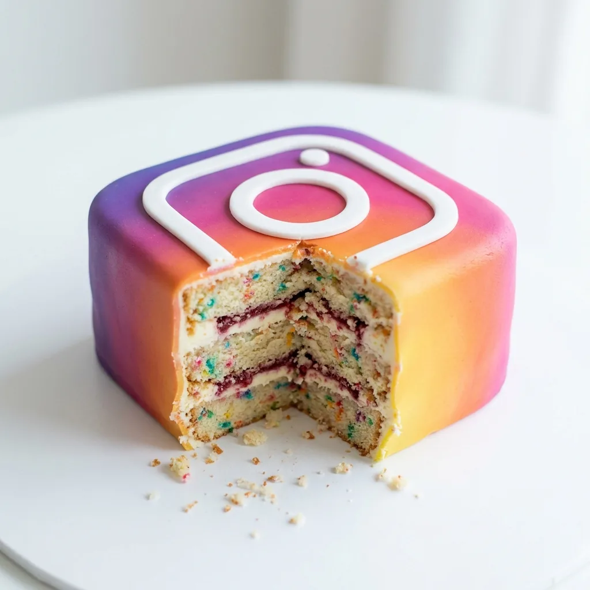

# Digital illustration of a cake meticulously stylized to resemble

[← Back to the collection](../../README.md) · Category: [Illustration & 3D](../../gallery/illustration-3d.md) · Model: `Vinano Image v2` · ID: `vn-00507`

<a href="https://vinano.ai?utm_source=github&utm_medium=readme&utm_campaign=awesome-image-video-prompts-updating&utm_content=prompt-page-image"></a>

<sub>Preview generated with <a href="https://vinano.ai?utm_source=github&utm_medium=readme&utm_campaign=awesome-image-video-prompts-updating&utm_content=prompt-page-caption">vinano.ai</a></sub>

## Prompt

```text
Generate a hyper-realistic digital illustration of a cake meticulously stylized to resemble a [LOGO] resting on a pristine white table. Show it partially bitten to reveal multiple delicious layers (sponge, frosting, crumbs) and shatter the illusion. Capture the moment of surprise intricate details in the bite mark. Use a slightly overhead angle to emphasize the contrast between the realistic outer shell and the cake interior. Illuminate the scene soft, diffused lighting to enhance textures and cast subtle shadows for depth. Keep the background minimal and bright to focus on the deceptive dessert. Employ a vibrant, playful palette for the cake layers against the object-mimicking exterior. Render in a true-to-life photorealistic style whimsical undertones, making the reveal both visually convincing and appetizing. Render with rich micro-detail while keeping the layout uncluttered and intentional.
```

## Try it on vinano.ai

1. Copy the prompt above.
2. Open **[vinano.ai](https://vinano.ai?utm_source=github&utm_medium=readme&utm_campaign=awesome-image-video-prompts-updating&utm_content=prompt-page-try)**, paste it into the image generator and pick a model.
3. Swap any placeholders (brand, product, city, person…) for your own details, then generate.

More prompts like this: [Illustration & 3D gallery](../../gallery/illustration-3d.md) · [all categories](../../README.md#contents)
