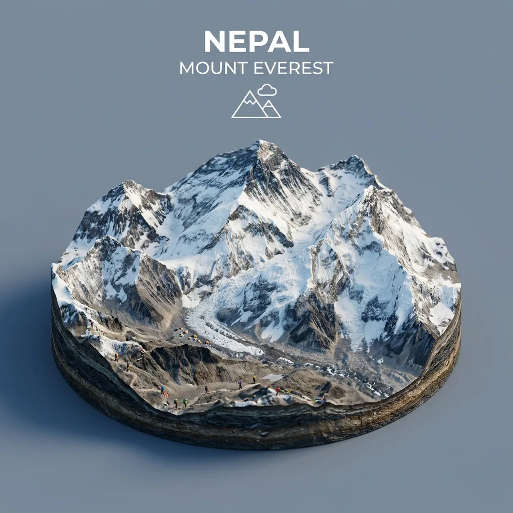

# Isometric miniature 3D diorama highlighting the natural landmark NATURAL

[← Back to the collection](../../README.md) · Category: [Illustration & 3D](../../gallery/illustration-3d.md) · Model: `Vinano Image Pro` · ID: `vn-00524`

<a href="https://vinano.ai?utm_source=github&utm_medium=readme&utm_campaign=awesome-image-video-prompts-updating&utm_content=prompt-page-image"></a>

<sub>Preview generated with <a href="https://vinano.ai?utm_source=github&utm_medium=readme&utm_campaign=awesome-image-video-prompts-updating&utm_content=prompt-page-caption">vinano.ai</a></sub>

## Prompt

```text
Create an isometric miniature 3D diorama highlighting the natural landmark [NATURAL WONDER] from [COUNTRY NAME/PLANET].

Use a 40–45° top-down view. Textures look organic and realistic PBR materials. Lighting feels soft and atmospheric.

The raised base shows terrain layers, vegetation, and surrounding geography. Add tiny stylized explorers or wildlife no facial details.

Background remains solid [BACKGROUND COLOR].

Top center text displays [COUNTRY NAME] in bold.
Second line shows [NATURAL WONDER]. Place a minimal nature icon below. Text automatically adapts for contrast.

Emphasise material texture and natural light so the final frame feels tactile and premium.
```

## Try it on vinano.ai

1. Copy the prompt above.
2. Open **[vinano.ai](https://vinano.ai?utm_source=github&utm_medium=readme&utm_campaign=awesome-image-video-prompts-updating&utm_content=prompt-page-try)**, paste it into the image generator and pick a model.
3. Swap any placeholders (brand, product, city, person…) for your own details, then generate.

More prompts like this: [Illustration & 3D gallery](../../gallery/illustration-3d.md) · [all categories](../../README.md#contents)
