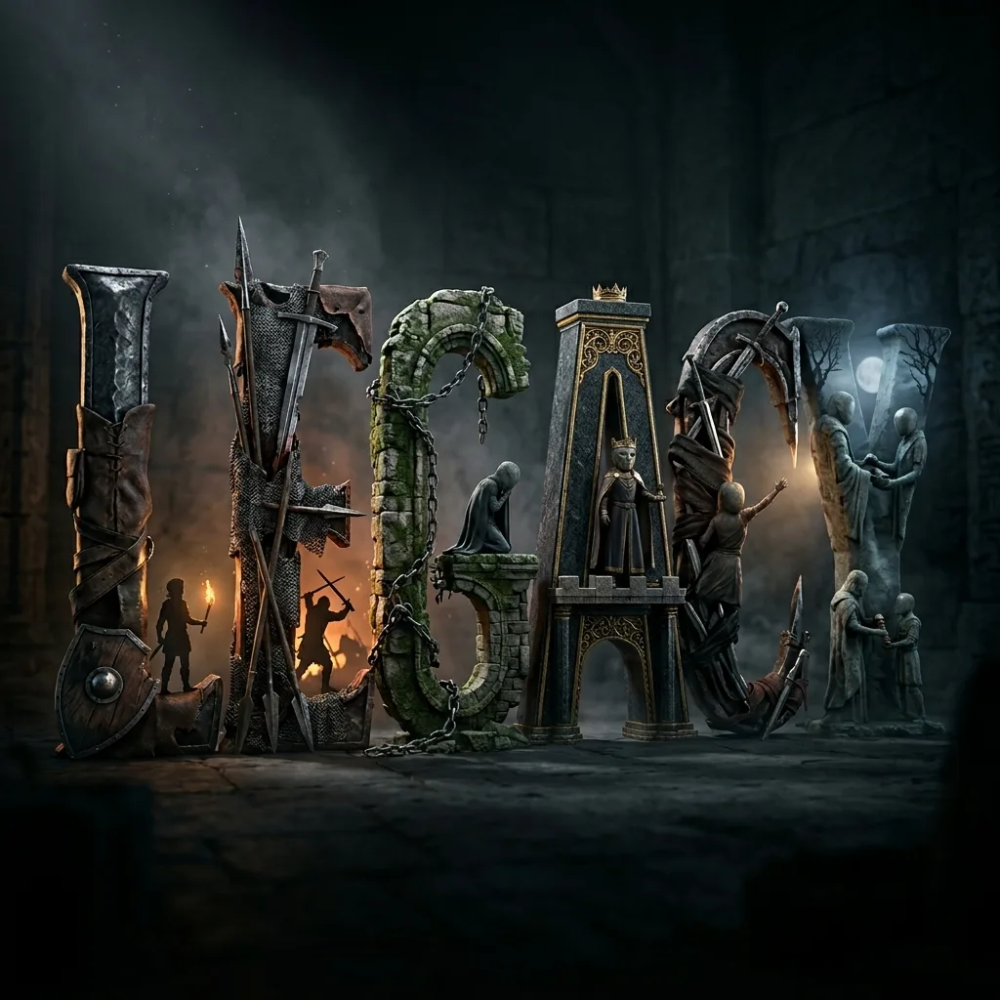

# 3D typographic composition spelling WORD / NAME , where

[← Back to the collection](../../README.md) · Category: [Illustration & 3D](../../gallery/illustration-3d.md) · Model: `Vinano Image Pro` · ID: `vn-00525`

<a href="https://vinano.ai?utm_source=github&utm_medium=readme&utm_campaign=awesome-image-video-prompts-updating&utm_content=prompt-page-image"></a>

<sub>Preview generated with <a href="https://vinano.ai?utm_source=github&utm_medium=readme&utm_campaign=awesome-image-video-prompts-updating&utm_content=prompt-page-caption">vinano.ai</a></sub>

## Prompt

```text
Create a cinematic 3D typographic composition spelling [WORD / NAME], where each letter is sculpted from the personality, environment, and emotional arc of [CHARACTER / STORY].

Letters are formed clothing textures, symbolic props, architecture, and lighting motifs tied to different moments of the narrative.

No literal faces — identity is conveyed through silhouettes, posture, materials, and atmosphere. Use premium metallic or stone materials subtle wear.

Dark cinematic background, dramatic rim lighting, deep shadows, ultra-realistic render, film-title quality.

Emphasise material texture and natural light so the final frame feels tactile and premium.
```

## Try it on vinano.ai

1. Copy the prompt above.
2. Open **[vinano.ai](https://vinano.ai?utm_source=github&utm_medium=readme&utm_campaign=awesome-image-video-prompts-updating&utm_content=prompt-page-try)**, paste it into the image generator and pick a model.
3. Swap any placeholders (brand, product, city, person…) for your own details, then generate.

More prompts like this: [Illustration & 3D gallery](../../gallery/illustration-3d.md) · [all categories](../../README.md#contents)
