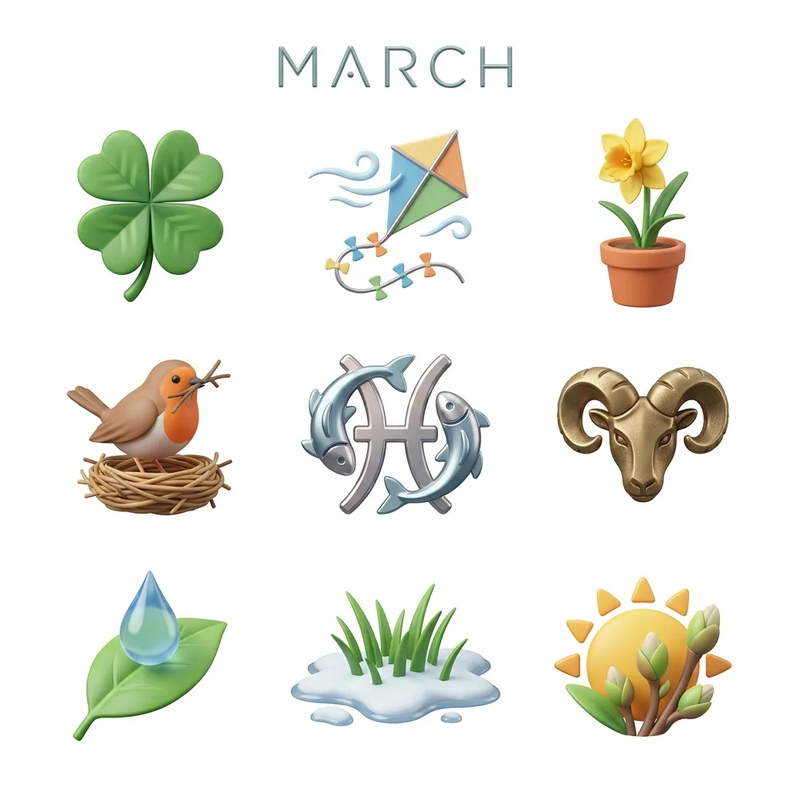

# Collection of icons representing Month through objects, symbols,

[← Back to the collection](../../README.md) · Category: [Illustration & 3D](../../gallery/illustration-3d.md) · Model: `Vinano Image Pro` · ID: `vn-00529`

<a href="https://vinano.ai?utm_source=github&utm_medium=readme&utm_campaign=awesome-image-video-prompts-updating&utm_content=prompt-page-image"></a>

<sub>Preview generated with <a href="https://vinano.ai?utm_source=github&utm_medium=readme&utm_campaign=awesome-image-video-prompts-updating&utm_content=prompt-page-caption">vinano.ai</a></sub>

## Prompt

```text
Create a collection of icons representing [Month] through objects, symbols, and moods.
They belong together as a single cohesive theme.
The background is pure white.

Place the month name “[MONTH]” at the top center of the image as a minimal, balanced title, aligned symmetrically above the grid and visually integrated the overall design.

Icons are rendered in a colorful yet calm 3D style, season-appropriate textures and atmospheric lighting that reflect the essence of [MONTH].

Maintain consistent proportions, materials, and visual language across all icons and the title.

Maintain consistent colour harmony and crisp focus across the whole frame.
```

## Try it on vinano.ai

1. Copy the prompt above.
2. Open **[vinano.ai](https://vinano.ai?utm_source=github&utm_medium=readme&utm_campaign=awesome-image-video-prompts-updating&utm_content=prompt-page-try)**, paste it into the image generator and pick a model.
3. Swap any placeholders (brand, product, city, person…) for your own details, then generate.

More prompts like this: [Illustration & 3D gallery](../../gallery/illustration-3d.md) · [all categories](../../README.md#contents)
