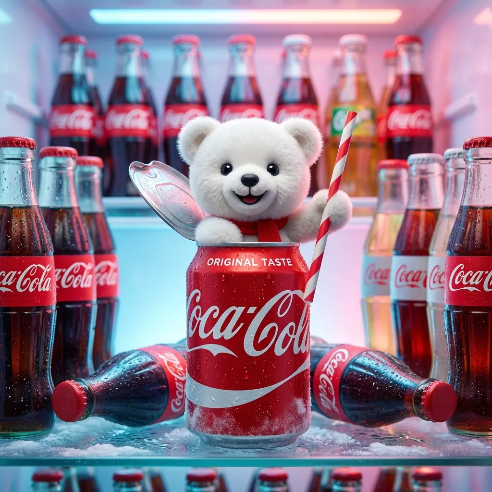

# Cute, cinematic brand fantasy scene featuring a fluffy white

[← Back to the collection](../../README.md) · Category: [Illustration & 3D](../../gallery/illustration-3d.md) · Model: `Vinano Image v2` · ID: `vn-00531`

<a href="https://vinano.ai?utm_source=github&utm_medium=readme&utm_campaign=awesome-image-video-prompts-updating&utm_content=prompt-page-image"></a>

<sub>Preview generated with <a href="https://vinano.ai?utm_source=github&utm_medium=readme&utm_campaign=awesome-image-video-prompts-updating&utm_content=prompt-page-caption">vinano.ai</a></sub>

## Prompt

```text
A cute, cinematic brand fantasy scene featuring a fluffy white teddy bear mascot emerging from a chilled soda Coca-Cola can, holding a colorful striped straw.

The can is placed inside a glowing refrigerator filled neatly stacked glass soda bottles. Soft neon lighting, pastel reflections, condensation droplets on metal, playful yet premium advertising style. Shallow depth of field, ultra-detailed fur texture, glossy highlights, vibrant red-and-white color pal-ette, whimsical mood, Pixar-level realism, stu-dio-quality lighting, high contrast, square composi-tion, 1080×1080, ultra-HD, commercial brand photog-raphy.

Render with rich micro-detail while keeping the layout uncluttered and intentional.
```

## Try it on vinano.ai

1. Copy the prompt above.
2. Open **[vinano.ai](https://vinano.ai?utm_source=github&utm_medium=readme&utm_campaign=awesome-image-video-prompts-updating&utm_content=prompt-page-try)**, paste it into the image generator and pick a model.
3. Swap any placeholders (brand, product, city, person…) for your own details, then generate.

More prompts like this: [Illustration & 3D gallery](../../gallery/illustration-3d.md) · [all categories](../../README.md#contents)
