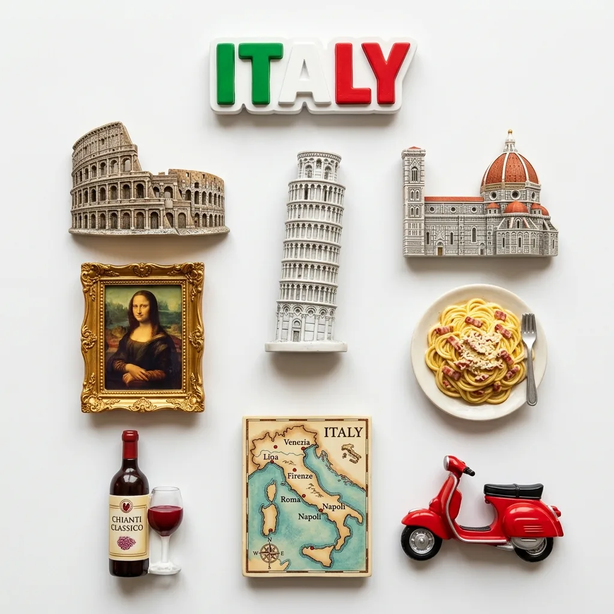

# Flat-lay collection of exactly 9 hyper-realistic 3D resin fridge

[← Back to the collection](../../README.md) · Category: [Illustration & 3D](../../gallery/illustration-3d.md) · Model: `Vinano Image Pro` · ID: `vn-00535`

<a href="https://vinano.ai?utm_source=github&utm_medium=readme&utm_campaign=awesome-image-video-prompts-updating&utm_content=prompt-page-image"></a>

<sub>Preview generated with <a href="https://vinano.ai?utm_source=github&utm_medium=readme&utm_campaign=awesome-image-video-prompts-updating&utm_content=prompt-page-caption">vinano.ai</a></sub>

## Prompt

```text
A flat-lay collection of exactly 9 hyper-realistic 3D resin fridge magnets arranged on a plain matte white surface, themed around [COUNTRY]. At the very top center, a wide rectangular text magnet spells "COUNTRY" in bold 3D block letters colored in the nation's flag colors. Below it, 8 magnets are arranged in a loose 3-column grid: 3 iconic architectural landmarks as highly detailed sculpted miniature reliefs (cathedrals, towers, castles, monuments), 1 famous painting or portrait reproduced inside a gold ornate picture frame magnet, 1 traditional food dish and 1 drink (wine bottle + glass, or beer stein, etc.) as glossy ceramic sculpted magnets, 1 illustrated vintage-style map magnet of the country city markers, and 1 additional cultural symbol or landmark. Each magnet has a slightly raised 3D sculpted look soft drop shadows on the white surface beneath. Warm studio lighting from above, true-to-life photorealistic product render, perfectly clean white background, top-down flat-lay angle, 4:5 aspect ratio. Maintain consistent colour harmony and crisp focus across the whole frame.
```

## Try it on vinano.ai

1. Copy the prompt above.
2. Open **[vinano.ai](https://vinano.ai?utm_source=github&utm_medium=readme&utm_campaign=awesome-image-video-prompts-updating&utm_content=prompt-page-try)**, paste it into the image generator and pick a model.
3. Swap any placeholders (brand, product, city, person…) for your own details, then generate.

More prompts like this: [Illustration & 3D gallery](../../gallery/illustration-3d.md) · [all categories](../../README.md#contents)
