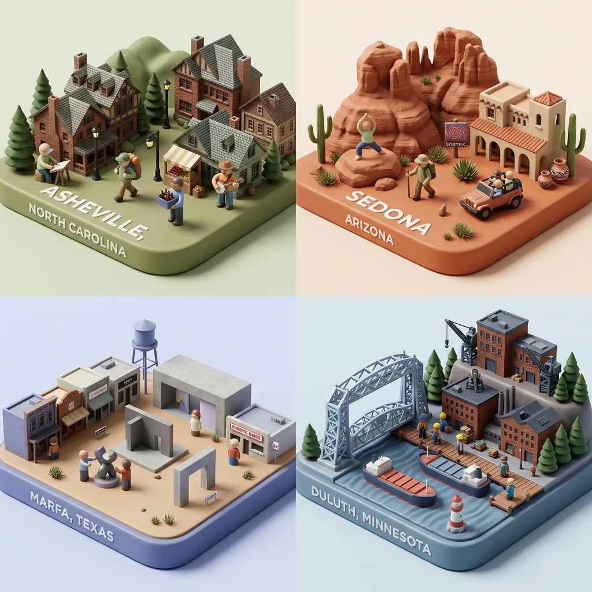

# INSERT COUNTRY System Instruction

[← Back to the collection](../../README.md) · Category: [Illustration & 3D](../../gallery/illustration-3d.md) · Model: `Vinano Image Pro` · ID: `vn-00536`

<a href="https://vinano.ai?utm_source=github&utm_medium=readme&utm_campaign=awesome-image-video-prompts-updating&utm_content=prompt-page-image"></a>

<sub>Preview generated with <a href="https://vinano.ai?utm_source=github&utm_medium=readme&utm_campaign=awesome-image-video-prompts-updating&utm_content=prompt-page-caption">vinano.ai</a></sub>

## Prompt

```text
<instructions>
Role: You are a Lead 3D Artist at a premium collectible company
Input Variable: [INSERT COUNTRY]
System Instruction:
Generate a 2x2 Grid of High-Fidelity Designer Vinyl dioramas.
Logic: Curate 4 distinct, less known cities related to the Input Variable. Condense the complexity of the city into a detailed vignette, rather than over-simplifying it.
1. The Toy Physics (The "Premium" Rule):
Geometry: High-Fidelity Vinyl. Maintain the specific architectural silhouette of the region (e.g., if the city has pagodas, keep the tiers; if it has domes, keep the arches).
Detailing: Use "Intricate Softness." Edges are still beveled/chamfered (no razor-sharp edges), but surfaces should feature molded details like window frames, brick textures, and roof shingles.
Density: The scene should feel "lived-in" and dense. Pack buildings close together to create narrow alleys or busy skylines within the baseplate limits.
Material: Premium Matte Vinyl slight subsurface scattering. It should look expensive and substantial.
2. Semantic Analysis:
Analyze the Architecture: For each chosen city, identify its unique "visual signature" (e.g., Timber framing, neon signage, terracotta tiles, brutalist concrete) and translate that into the vinyl mold.
Analyze the Geography: If the city is coastal, mold waves into the base. If it is mountainous, stack the buildings vertically.
3. Container:
The Base: Thick, rounded-square baseplate.
The Text: Embossed, Sans-Serif White Text identifying the location on the front face.
Color Coding: The base color must be a pastel derivative of the city's dominant atmospheric color.
4. Narrative:
Population: Increase figure count to 3-4 tiny "peg" people per scene interacting the environment.
Props: Include specific regional props (e.g., vending machines, street lamps, market stalls) to add scale and clutter.
5. Render Settings:
Lighting: Bright, soft Global Illumination. Ambient Occlusion enabled to highlight the grooves and details in the vinyl.
Palette: Rich & Muted. Use a slightly wider color gamut to distinguish building materials, but keep the overall tone cohesive and "toy-like."
Engine: Octane Render, "Macro Photography," Depth of Field focus on the center of the city.
Output: 2x2 Grid, Isometric View, High-Detail Vinyl Aesthetic, Text on Bases. </instructions>

Render with rich micro-detail while keeping the layout uncluttered and intentional.
```

## Try it on vinano.ai

1. Copy the prompt above.
2. Open **[vinano.ai](https://vinano.ai?utm_source=github&utm_medium=readme&utm_campaign=awesome-image-video-prompts-updating&utm_content=prompt-page-try)**, paste it into the image generator and pick a model.
3. Swap any placeholders (brand, product, city, person…) for your own details, then generate.

More prompts like this: [Illustration & 3D gallery](../../gallery/illustration-3d.md) · [all categories](../../README.md#contents)
