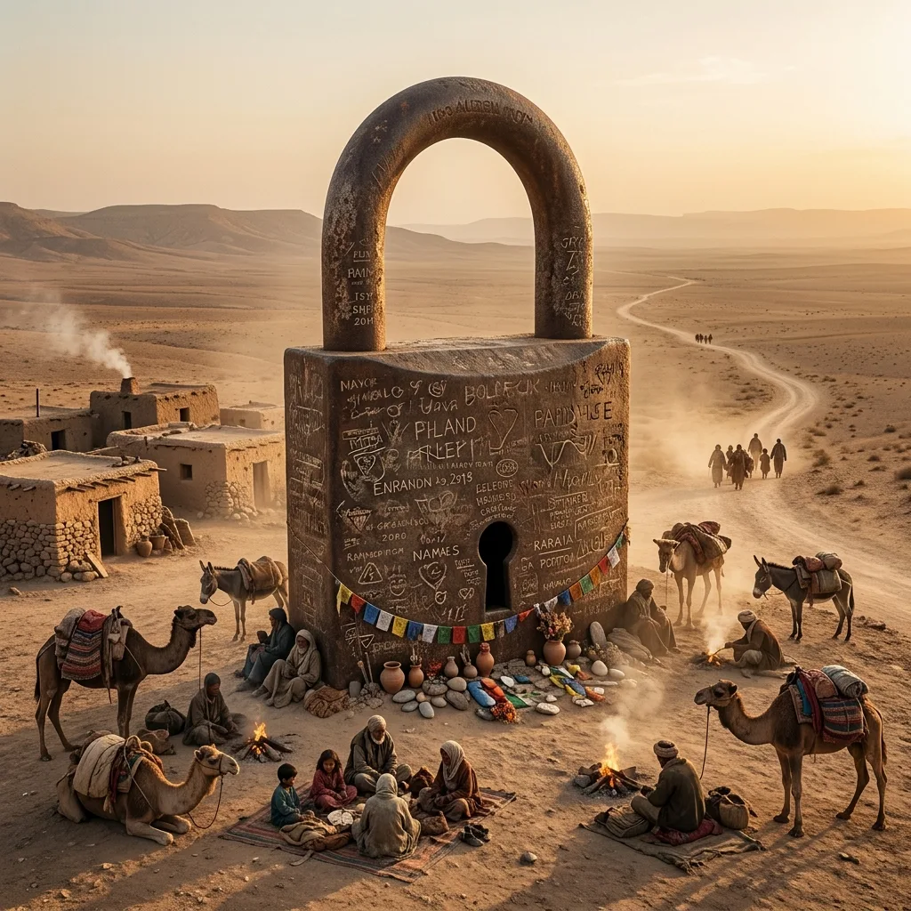

# ORDINARY OBJECT as a landmark on an epic journey

[← Back to the collection](../../README.md) · Category: [Illustration & 3D](../../gallery/illustration-3d.md) · Model: `Vinano Image v2` · ID: `vn-00539`

<a href="https://vinano.ai?utm_source=github&utm_medium=readme&utm_campaign=awesome-image-video-prompts-updating&utm_content=prompt-page-image"></a>

<sub>Preview generated with <a href="https://vinano.ai?utm_source=github&utm_medium=readme&utm_campaign=awesome-image-video-prompts-updating&utm_content=prompt-page-caption">vinano.ai</a></sub>

## Prompt

```text
A [ORDINARY OBJECT] as a landmark on an epic journey, tiny [TRAVELERS] resting in its shadow after crossing vast distances visible behind them. Caravans, pack animals, exhausted families. The object marks the halfway point, or the border, or the promised destination. Graffiti and carvings from generations of previous travelers cover its surfaces. Offerings left at its base. Some travelers stay, building permanent settlement. Others push on. Golden hour lighting, dust from the journey still settling, the mundane as waypoint. Render with rich micro-detail while keeping the layout uncluttered and intentional.
```

## Try it on vinano.ai

1. Copy the prompt above.
2. Open **[vinano.ai](https://vinano.ai?utm_source=github&utm_medium=readme&utm_campaign=awesome-image-video-prompts-updating&utm_content=prompt-page-try)**, paste it into the image generator and pick a model.
3. Swap any placeholders (brand, product, city, person…) for your own details, then generate.

More prompts like this: [Illustration & 3D gallery](../../gallery/illustration-3d.md) · [all categories](../../README.md#contents)
