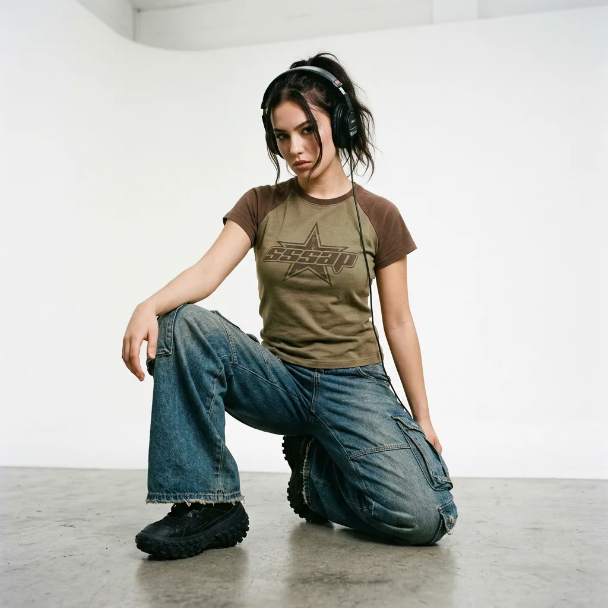

# She kneels in a pristine white studio

[← Back to the collection](../../README.md) · Category: [Illustration & 3D](../../gallery/illustration-3d.md) · Model: `Vinano Image v2` · ID: `vn-00543`

<a href="https://vinano.ai?utm_source=github&utm_medium=readme&utm_campaign=awesome-image-video-prompts-updating&utm_content=prompt-page-image"></a>

<sub>Preview generated with <a href="https://vinano.ai?utm_source=github&utm_medium=readme&utm_campaign=awesome-image-video-prompts-updating&utm_content=prompt-page-caption">vinano.ai</a></sub>

## Prompt

```text
She kneels in a pristine white studio, shot from a low mid angle a slight upward tilt that emphasizes quiet dominance. She wears a Y2K inspired brown and olive raglan tee a worn retro star logo reading sssap, paired oversized distressed wide leg denim cargos and chunky black streetwear shoes. Her messy ponytail and loose strands frame a sharp, defiant gaze, softened by large black wired headphones adding a cyber edge. Soft diffused studio lighting reveals fabric texture and subtle shadows, while her provocative yet controlled expression channels indie sleaze mixed Harajuku editorial rebellion. Render with rich micro-detail while keeping the layout uncluttered and intentional.
```

## Try it on vinano.ai

1. Copy the prompt above.
2. Open **[vinano.ai](https://vinano.ai?utm_source=github&utm_medium=readme&utm_campaign=awesome-image-video-prompts-updating&utm_content=prompt-page-try)**, paste it into the image generator and pick a model.
3. Swap any placeholders (brand, product, city, person…) for your own details, then generate.

More prompts like this: [Illustration & 3D gallery](../../gallery/illustration-3d.md) · [all categories](../../README.md#contents)
