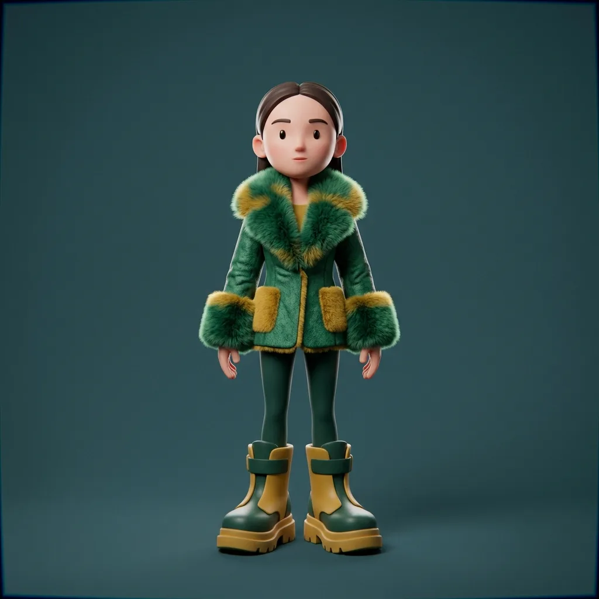

# Blender Cycles / Unreal Engine 5 Lumen

[← Back to the collection](../../README.md) · Category: [Illustration & 3D](../../gallery/illustration-3d.md) · Model: `Vinano Image v2` · ID: `vn-00551`

<a href="https://vinano.ai?utm_source=github&utm_medium=readme&utm_campaign=awesome-image-video-prompts-updating&utm_content=prompt-page-image"></a>

<sub>Preview generated with <a href="https://vinano.ai?utm_source=github&utm_medium=readme&utm_campaign=awesome-image-video-prompts-updating&utm_content=prompt-page-caption">vinano.ai</a></sub>

## Prompt

```text
{
 "renderEngine": "Blender Cycles / Unreal Engine 5 Lumen",
 "baseStyle": "Stylized 3D CGI character — Pixar meets high-fashion editorial",
 "proportions": "Slightly enlarged head (1.3x natural), compact torso, simplified facial features, exaggerated chunky feet/shoes",
 "skinShader": "Subsurface scattering physically-based roughness, no pores, smooth cartoon-like finish",
 "clothingPhysics": "Marvelous Designer simulation baked in, wrinkle maps, fabric-specific material shaders",
 "furTech": "XGen or Ornatrix volumetric fur for faux-fur pieces, physics-simulated",
 "resolution": "8192x8192px minimum, 300DPI",
 "backgroundStyle": "Solid flat color, no gradient, no texture — studio seamless backdrop",
 "lightingRig": "Three-point studio: key (45° front-top), fill (opposite side soft), rim (back edge definition)",
 "cameraLens": "35-50mm equivalent, slight vignette, no fisheye",
 "postProcessing": "Subtle chromatic aberration on edges, mild film grain 2%, slight color grade"
}

Keep edges clean and the overall composition balanced for a polished, gallery-ready result.
```

## Try it on vinano.ai

1. Copy the prompt above.
2. Open **[vinano.ai](https://vinano.ai?utm_source=github&utm_medium=readme&utm_campaign=awesome-image-video-prompts-updating&utm_content=prompt-page-try)**, paste it into the image generator and pick a model.
3. Swap any placeholders (brand, product, city, person…) for your own details, then generate.

More prompts like this: [Illustration & 3D gallery](../../gallery/illustration-3d.md) · [all categories](../../README.md#contents)
