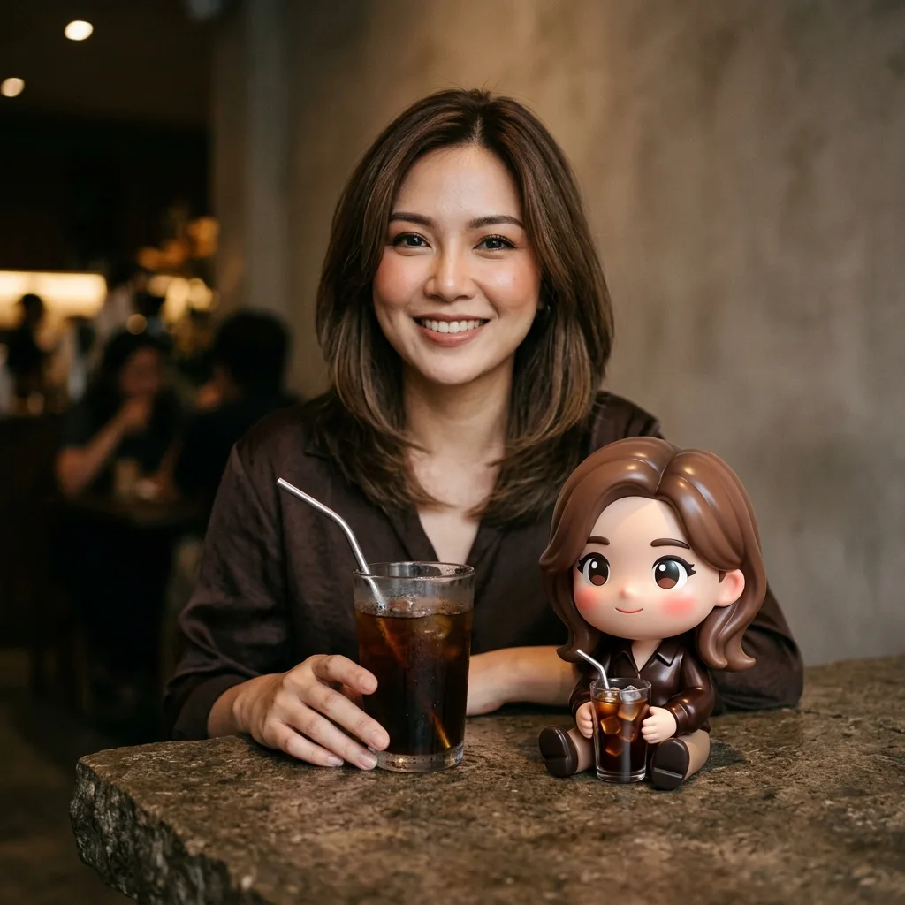

# Studio portrait of a woman seated at a textured

[← Back to the collection](../../README.md) · Category: [Illustration & 3D](../../gallery/illustration-3d.md) · Model: `Vinano Image v2` · ID: `vn-00558`

<a href="https://vinano.ai?utm_source=github&utm_medium=readme&utm_campaign=awesome-image-video-prompts-updating&utm_content=prompt-page-image"></a>

<sub>Preview generated with <a href="https://vinano.ai?utm_source=github&utm_medium=readme&utm_campaign=awesome-image-video-prompts-updating&utm_content=prompt-page-caption">vinano.ai</a></sub>

## Prompt

```text
A cinematic studio portrait of a woman seated at a textured stone table against a muted warm gray background. She wears a dark brown satin blouse, subtle evening makeup, and softly layered shoulder-length hair. In front of her is a glass of cold brew coffee ice and a metal straw. Placed beside it is a glossy 3D chibi figurine of the same woman, a big rounded head, expressive eyes, soft blush cheeks, and simplified facial features, holding a miniature cold brew glass. The chibi has a premium-quality collectible toy look gentle reflections. Intimate evening café vibe, moody soft, diffused lighting, shallow depth of field, realistic human combined stylized 3D character, cinematic and cozy, 1:1 aspect ratio. Render with rich micro-detail while keeping the layout uncluttered and intentional.
```

## Try it on vinano.ai

1. Copy the prompt above.
2. Open **[vinano.ai](https://vinano.ai?utm_source=github&utm_medium=readme&utm_campaign=awesome-image-video-prompts-updating&utm_content=prompt-page-try)**, paste it into the image generator and pick a model.
3. Swap any placeholders (brand, product, city, person…) for your own details, then generate.

More prompts like this: [Illustration & 3D gallery](../../gallery/illustration-3d.md) · [all categories](../../README.md#contents)
