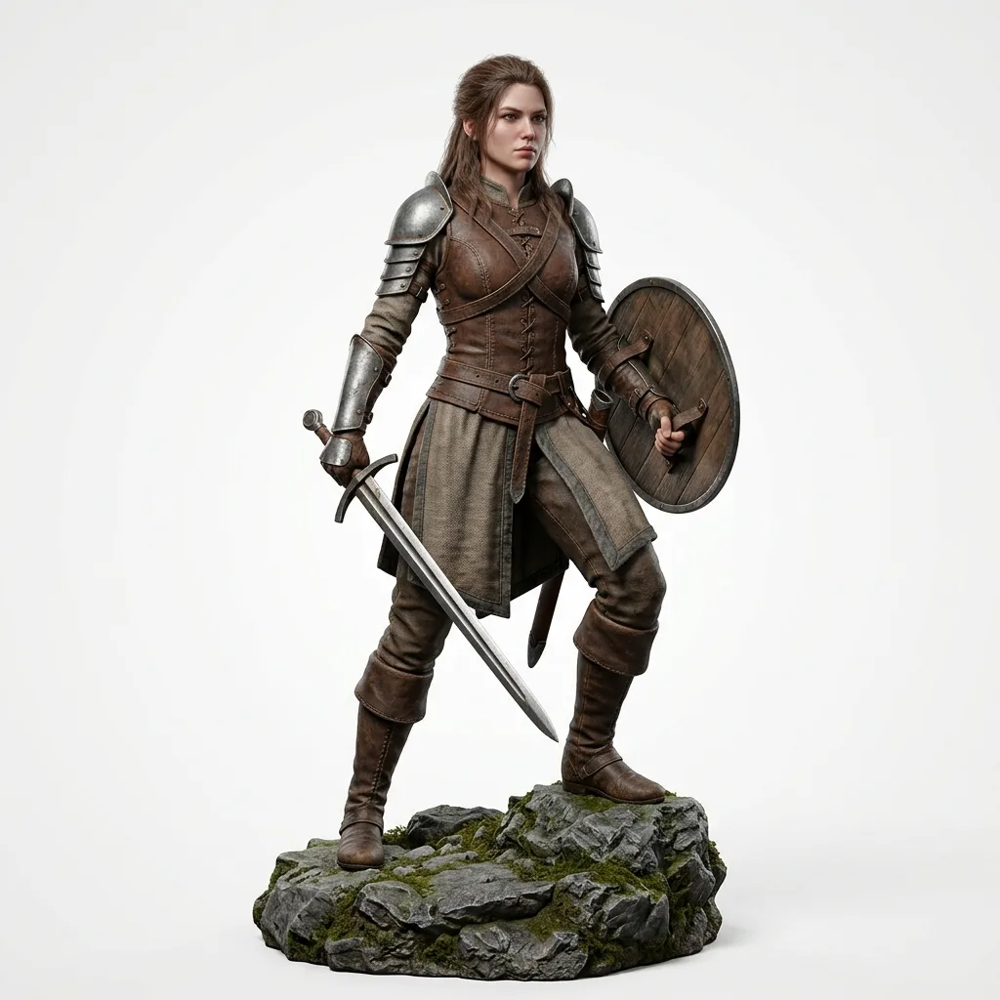

# Convert to hyper-realistic 3D CGI collectible figurine render

[← Back to the collection](../../README.md) · Category: [Illustration & 3D](../../gallery/illustration-3d.md) · Model: `Vinano Image v2` · ID: `vn-00569`

<a href="https://vinano.ai?utm_source=github&utm_medium=readme&utm_campaign=awesome-image-video-prompts-updating&utm_content=prompt-page-image"></a>

<sub>Preview generated with <a href="https://vinano.ai?utm_source=github&utm_medium=readme&utm_campaign=awesome-image-video-prompts-updating&utm_content=prompt-page-caption">vinano.ai</a></sub>

## Prompt

```text
Convert to hyper-realistic 3D CGI collectible figurine render. Physically-based rendering, octane render quality. Preserve the original character design, pose, and outfit exactly. Transform all surfaces into real-world materials: fabric visible weave and drape, metal wear, scratches and oxidation, synthetic matte skin. Pure white studio background, clean seamless white backdrop, soft diffused lighting subtle rim light. No cel shading, no toon rendering. High-end statue/collectible photography aesthetic. Ultra detailed, 8K. Fix and reconstruct all hands and fingers correct anatomy: natural finger count, proper joint articulation, realistic proportions, no fused or melted digits. Remove all 2D artifacts, compression glitches, and inconsistencies. Ensure full anatomical coherence across the entire figure: symmetrical features, clean silhouette, no floating elements, no distorted limbs, no duplicated body parts. Hyper-detailed hair simulation: individual strand rendering, realistic hair clumping, natural flow and gravity, visible scalp at roots, micro flyaways, SSS translucency on hair tips. Every surface pushed to maximum realism: pore-level skin texture, fabric fiber micro-detail, specular highlights on every material, depth in shadows Keep edges clean and the overall composition balanced for a polished, gallery-ready result.
```

## Try it on vinano.ai

1. Copy the prompt above.
2. Open **[vinano.ai](https://vinano.ai?utm_source=github&utm_medium=readme&utm_campaign=awesome-image-video-prompts-updating&utm_content=prompt-page-try)**, paste it into the image generator and pick a model.
3. Swap any placeholders (brand, product, city, person…) for your own details, then generate.

More prompts like this: [Illustration & 3D gallery](../../gallery/illustration-3d.md) · [all categories](../../README.md#contents)
