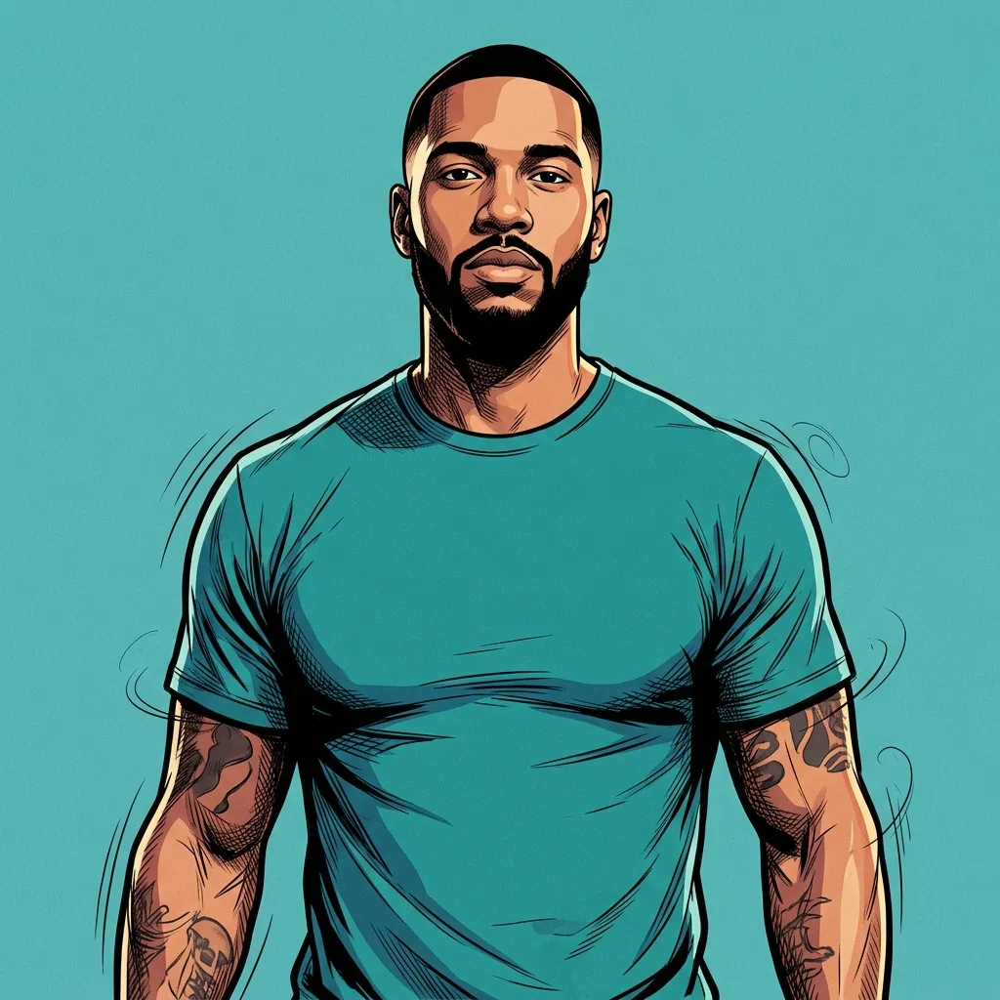

# High-contrast digital comic-style illustration of PERSON based strictly

[← Back to the collection](../../README.md) · Category: [Illustration & 3D](../../gallery/illustration-3d.md) · Model: `Vinano Image Pro` · ID: `vn-00579`

<a href="https://vinano.ai?utm_source=github&utm_medium=readme&utm_campaign=awesome-image-video-prompts-updating&utm_content=prompt-page-image"></a>

<sub>Preview generated with <a href="https://vinano.ai?utm_source=github&utm_medium=readme&utm_campaign=awesome-image-video-prompts-updating&utm_content=prompt-page-caption">vinano.ai</a></sub>

## Prompt

```text
Create a high-contrast digital comic-style illustration of [PERSON] based strictly on the provided reference image.
STRICT IDENTITY LOCK:
∙Preserve exact facial bone structure
∙Preserve exact skin tone
∙Preserve beard density and shape (if applicable)
∙Preserve tattoo placement and design (if visible)
∙Do NOT stylize, redesign, beautify, exaggerate, or cartoonify the face
∙The person must remain clearly recognizable
POSE:
Upper-body focused composition.
Keep the pose exactly the same as in the reference image.
STYLE:
∙Bold black ink outlines
∙Strong dynamic line variation
∙Clean comic-book contouring
∙Cross-hatching shading technique (visible hand-drawn hatch lines)
∙No soft airbrush shading
∙No smooth gradient blending
∙Hard shadow planes
∙Graphic novel illustration style
COLOR SYSTEM:
∙Flat saturated color blocks
∙High contrast between light and shadow
∙No true-to-life photorealistic rendering
∙No painterly brush strokes
∙Slight warm skin highlights
∙Clothing colors must match the reference image exactly
TEXTURE:
∙Subtle paper grain texture
∙Ink illustration feel
∙Hand-drawn motion lines around arms and shoulders
BACKGROUND:
∙Solid flat background color complementary to the subject’s outfit or chosen palette
∙No environment
∙No depth blur
∙Minimalistic
∙Slight grain texture allowed
ENERGY DETAILS:
∙Hand-drawn motion lines indicating movement
∙Subtle sketch swirls around the subject
∙Dynamic comic vibration lines
LIGHTING:
∙Strong directional light from upper side
∙Hard comic-style shadow edges
∙Deep contrast under arms and jawline
∙Defined muscle contour shadows
COMPOSITION:
∙Vertical 4:5 ratio (Instagram optimized)
∙Subject centered
∙Upper torso dominant
∙Clean negative space around figure
QUALITY:
∙High resolution
∙Clean line clarity
∙Sharp edges
∙No blur
∙No AI artifact distortion

Render with rich micro-detail while keeping the layout uncluttered and intentional.
```

## Try it on vinano.ai

1. Copy the prompt above.
2. Open **[vinano.ai](https://vinano.ai?utm_source=github&utm_medium=readme&utm_campaign=awesome-image-video-prompts-updating&utm_content=prompt-page-try)**, paste it into the image generator and pick a model.
3. Swap any placeholders (brand, product, city, person…) for your own details, then generate.

More prompts like this: [Illustration & 3D gallery](../../gallery/illustration-3d.md) · [all categories](../../README.md#contents)
