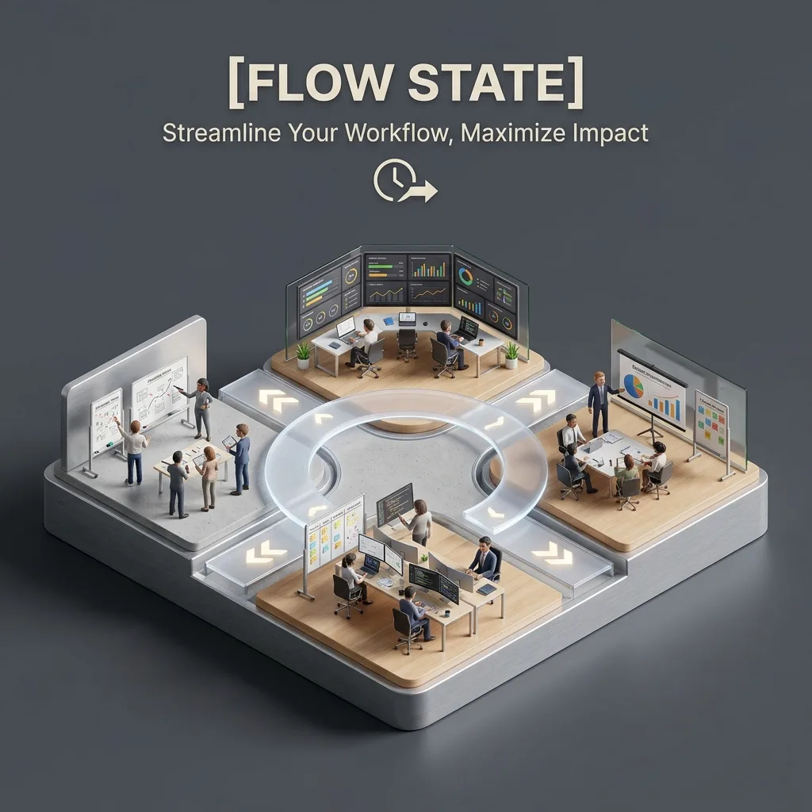

# 3D isometric miniature diorama showcasing the productivity system SYSTEM

[← Back to the collection](../../README.md) · Category: [Illustration & 3D](../../gallery/illustration-3d.md) · Model: `Vinano Image Pro` · ID: `vn-00580`

<a href="https://vinano.ai?utm_source=github&utm_medium=readme&utm_campaign=awesome-image-video-prompts-updating&utm_content=prompt-page-image"></a>

<sub>Preview generated with <a href="https://vinano.ai?utm_source=github&utm_medium=readme&utm_campaign=awesome-image-video-prompts-updating&utm_content=prompt-page-caption">vinano.ai</a></sub>

## Prompt

```text
Create a 3D isometric miniature diorama showcasing the productivity system [SYSTEM NAME]. Angle remains between 35–45°. Materials feel modern and structured realistic PBR textures.

Lighting is soft but focused. The raised base is divided into functional zones such as planning, execution, tracking, and review. Use connecting paths or arrows to show workflow.

Tiny stylized professionals interact desks, boards, or devices. heavy facial details.
Background remains solid [BACKGROUND COLOR].

Top center shows [SYSTEM NAME] in bold. Below it add a short benefit-focused subtitle. Place a minimal productivity icon underneath. Text automatically adapts.”

Emphasise material texture and natural light so the final frame feels tactile and premium.
```

## Try it on vinano.ai

1. Copy the prompt above.
2. Open **[vinano.ai](https://vinano.ai?utm_source=github&utm_medium=readme&utm_campaign=awesome-image-video-prompts-updating&utm_content=prompt-page-try)**, paste it into the image generator and pick a model.
3. Swap any placeholders (brand, product, city, person…) for your own details, then generate.

More prompts like this: [Illustration & 3D gallery](../../gallery/illustration-3d.md) · [all categories](../../README.md#contents)
