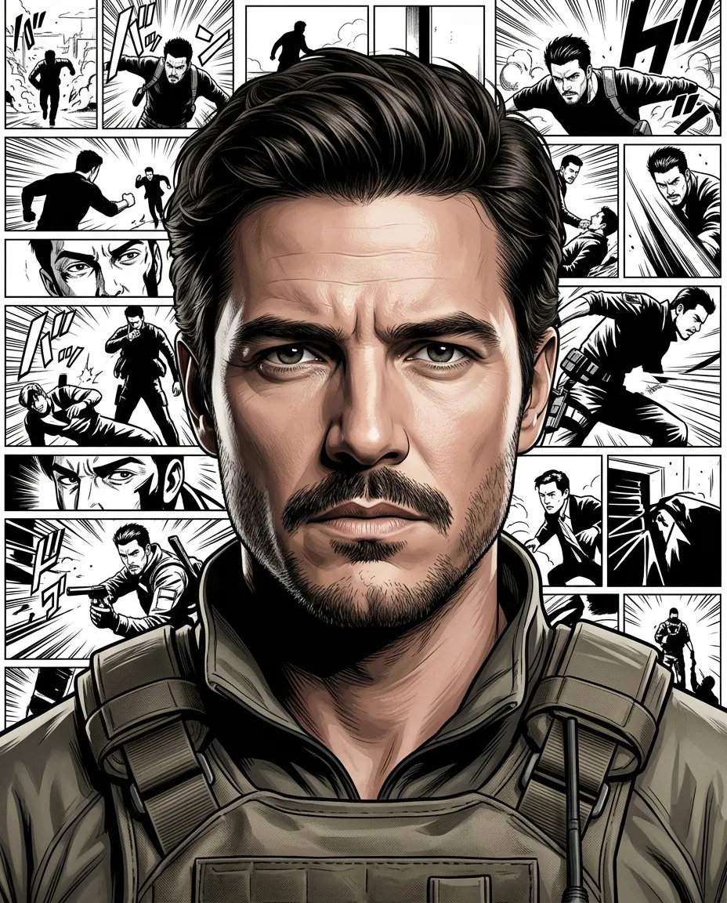

# Image in 4:5 ratio, hyper-realistic aesthetics applied

[← Back to the collection](../../README.md) · Category: [Illustration & 3D](../../gallery/illustration-3d.md) · Model: `Vinano Image Pro` · ID: `vn-00586`

<a href="https://vinano.ai?utm_source=github&utm_medium=readme&utm_campaign=awesome-image-video-prompts-updating&utm_content=prompt-page-image"></a>

<sub>Preview generated with <a href="https://vinano.ai?utm_source=github&utm_medium=readme&utm_campaign=awesome-image-video-prompts-updating&utm_content=prompt-page-caption">vinano.ai</a></sub>

## Prompt

```text
Create an image in 4:5 ratio, hyper-realistic aesthetics applied to a premium cartoon/cinematographic manga style, combining extreme realism high-impact illustrated visual language.

The face must be identical to that of the photo sent in 103%, maintaining absolute tidelity the original tactical identity: bone structure, skull shape, proportions, intense expression, eyebrows, eyes, nose, mouth, jaw, mustache, hair and capillary volume.

No aesthetic change, identity change, artificial smoothing or stylization that mischaracterizes the face.

Male character reference pose. Stroke style inspired by high-level realistic cartoon, well-defined volumes, deep shadows and clean finish.

costume: referenced image, realistic fabric texture, natural folds and precise lighting.

Background composed of black and white comic panels, organized in multiple narrative frames, creating depth, visual context and sensation of an expanded universe. The panels should look like action scenes and graphic narrative, varied perspective and dynamic composition.

Professional filmic, cinematic lighting, soft front main light and dramatic contrast, precise face enhancements, controlled shadows, subtle depth of field, extreme sharpness, visible microdetails, premium rendering finish.

Maximum quality, high-budget editorial illustration appearance, full focus on the face, strong visual impact, Realism 333%, no readable texts, no watermarks, no distortions, no artifacts.

Preserve realistic proportions and depth for a confident, professional finish.
```

## Try it on vinano.ai

1. Copy the prompt above.
2. Open **[vinano.ai](https://vinano.ai?utm_source=github&utm_medium=readme&utm_campaign=awesome-image-video-prompts-updating&utm_content=prompt-page-try)**, paste it into the image generator and pick a model.
3. Swap any placeholders (brand, product, city, person…) for your own details, then generate.

More prompts like this: [Illustration & 3D gallery](../../gallery/illustration-3d.md) · [all categories](../../README.md#contents)
