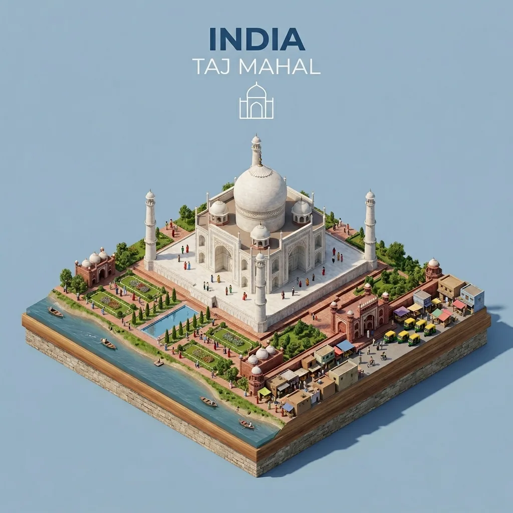

# Illustration & 3D prompt #592

[← Back to the collection](../../README.md) · Category: [Illustration & 3D](../../gallery/illustration-3d.md) · Model: `Vinano Image Pro` · ID: `vn-00592`

<a href="https://vinano.ai?utm_source=github&utm_medium=readme&utm_campaign=awesome-image-video-prompts-updating&utm_content=prompt-page-image"></a>

<sub>Preview generated with <a href="https://vinano.ai?utm_source=github&utm_medium=readme&utm_campaign=awesome-image-video-prompts-updating&utm_content=prompt-page-caption">vinano.ai</a></sub>

## Prompt

```text
\Create an isometric miniature 3D diorama representing the iconic architecture of [COUNTRY NAME] through [FAMOUS STRUCTURE]. Use a 45° top-down view.

Apply clean soft textures and realistic PBR materials.
Lighting feels balanced and natural. The raised base includes nearby streets, landscape features, and cultural details linked to the structure. Add tiny stylized locals and visitors heavy facial details.

Background stays solid [BACKGROUND COLOR]. Top center text shows [COUNTRY NAME] in bold. Second line shows [STRUCTURE NAME]. Place a minimal architecture icon below. Text color adjusts for contrast.

Preserve realistic proportions and depth for a confident, professional finish.
```

## Try it on vinano.ai

1. Copy the prompt above.
2. Open **[vinano.ai](https://vinano.ai?utm_source=github&utm_medium=readme&utm_campaign=awesome-image-video-prompts-updating&utm_content=prompt-page-try)**, paste it into the image generator and pick a model.
3. Swap any placeholders (brand, product, city, person…) for your own details, then generate.

More prompts like this: [Illustration & 3D gallery](../../gallery/illustration-3d.md) · [all categories](../../README.md#contents)
