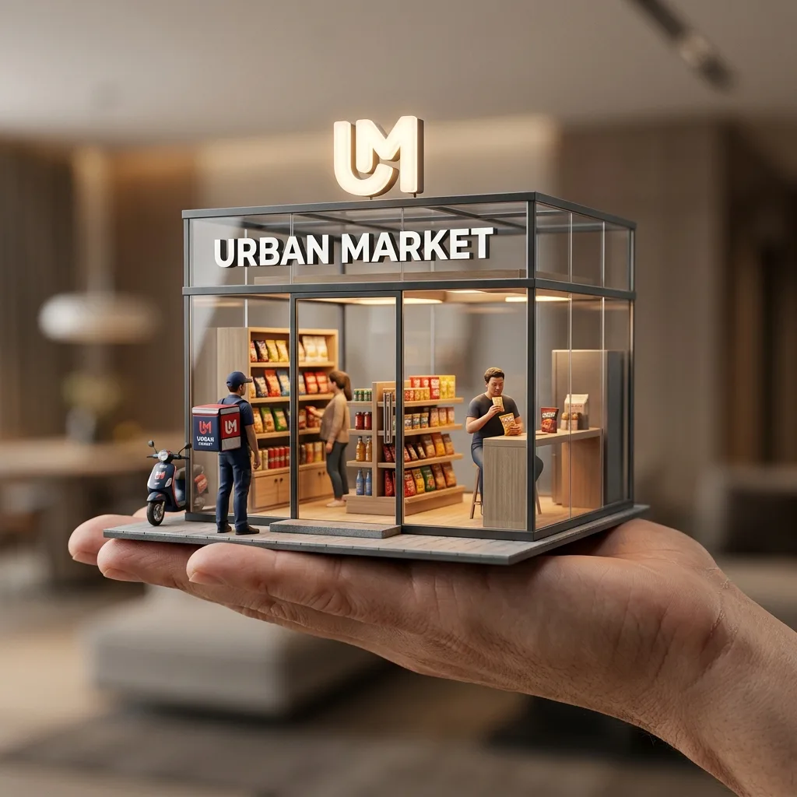

# Miniature YOUR BRAND showroom balanced on a human palm

[← Back to the collection](../../README.md) · Category: [Illustration & 3D](../../gallery/illustration-3d.md) · Model: `Vinano Image v2` · ID: `vn-00598`

<a href="https://vinano.ai?utm_source=github&utm_medium=readme&utm_campaign=awesome-image-video-prompts-updating&utm_content=prompt-page-image"></a>

<sub>Preview generated with <a href="https://vinano.ai?utm_source=github&utm_medium=readme&utm_campaign=awesome-image-video-prompts-updating&utm_content=prompt-page-caption">vinano.ai</a></sub>

## Prompt

```text
An ultra-realistic miniature [YOUR BRAND] showroom balanced on a human palm, designed transparent glass walls. Inside, tiny lifelike figures are enjoying [PRODUCTS]. On the rooftop, a glowing 3D logo shines brightly, while the front facade displays the brand name in a bold, recognizable typeface. Outside the showroom, a miniature delivery person is standing a branded delivery bag strapped to their back, ready to deliver orders.The showroom’s interior is styled like a cozy retail outlet, miniature products and branding details on display. Lighting is cinematic warm tones, crisp details, and natural shadows. Captured in professional product photography style, the scene conveys a vibrant, iconic, and instantly recognizable atmosphere. 1080x1080 dimension. Aim for an editorial, design-driven look with deliberate negative space.
```

## Try it on vinano.ai

1. Copy the prompt above.
2. Open **[vinano.ai](https://vinano.ai?utm_source=github&utm_medium=readme&utm_campaign=awesome-image-video-prompts-updating&utm_content=prompt-page-try)**, paste it into the image generator and pick a model.
3. Swap any placeholders (brand, product, city, person…) for your own details, then generate.

More prompts like this: [Illustration & 3D gallery](../../gallery/illustration-3d.md) · [all categories](../../README.md#contents)
