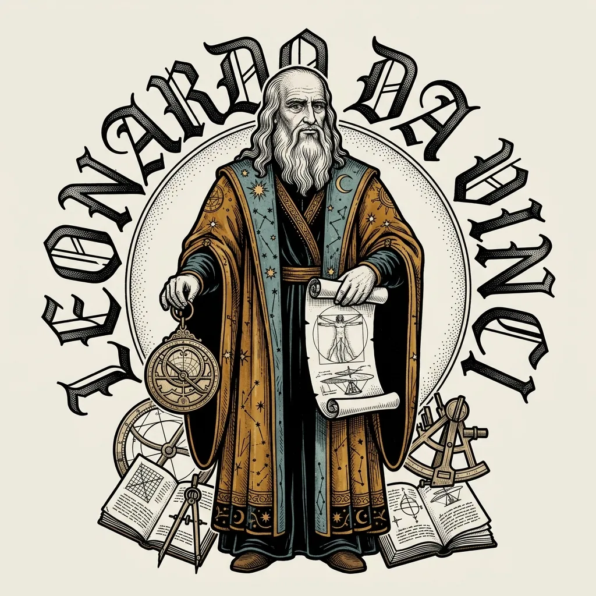

# Illustration & 3D prompt #610

[← Back to the collection](../../README.md) · Category: [Illustration & 3D](../../gallery/illustration-3d.md) · Model: `Vinano Image Pro` · ID: `vn-00610`

<a href="https://vinano.ai?utm_source=github&utm_medium=readme&utm_campaign=awesome-image-video-prompts-updating&utm_content=prompt-page-image"></a>

<sub>Preview generated with <a href="https://vinano.ai?utm_source=github&utm_medium=readme&utm_campaign=awesome-image-video-prompts-updating&utm_content=prompt-page-caption">vinano.ai</a></sub>

## Prompt

```text
[PERSONE]. Act as a Creative Director and Master of Visual Metaphor.

PHASE 1: DYNAMIC ARCHETYPE LOGIC.

Autonomously analyze the core essence of [PERSONE] and assign them a "High-Status Sovereign" role:

- If the character is a scientist/intellectual: Depict as a "Grand Archivist" in heavy velvet robes celestial instruments.

- If the character is a rebel/anti-hero: Depict as a "Wasteland Prophet" in deconstructed, layered streetwear and scavenged textures.

- If the character is royalty/leader: Depict as a "Divine Monarch" in stiff, ornamental ceremonial attire.

- Maintain the stoic, iconographic pose from the reference.

PHASE 2: ART STYLE & INK (THE REFERENCE LOOK).

Strictly follow the "Neo-Traditional Etching" style.

- Bold black ink outlines, intricate cross-hatching, and stippling for shadows.

- Color Palette: Deep Ochre, Faded Teal, Jet Black, and Bone White background.

PHASE 3: DYNAMIC TYPOGRAPHY.

- The massive Gothic/Blackletter halo behind the subject MUST explicitly spell out the name "[PERSONE]".

- The font style should adapt to the archetype (e.g., sharp and aggressive for rebels, elegant and structured for scholars).

TECH SPECS:

2D flat illustration, white background, ink-bleed effects, high contrast, sharp line-work.

Emphasise material texture and natural light so the final frame feels tactile and premium.
```

## Try it on vinano.ai

1. Copy the prompt above.
2. Open **[vinano.ai](https://vinano.ai?utm_source=github&utm_medium=readme&utm_campaign=awesome-image-video-prompts-updating&utm_content=prompt-page-try)**, paste it into the image generator and pick a model.
3. Swap any placeholders (brand, product, city, person…) for your own details, then generate.

More prompts like this: [Illustration & 3D gallery](../../gallery/illustration-3d.md) · [all categories](../../README.md#contents)
