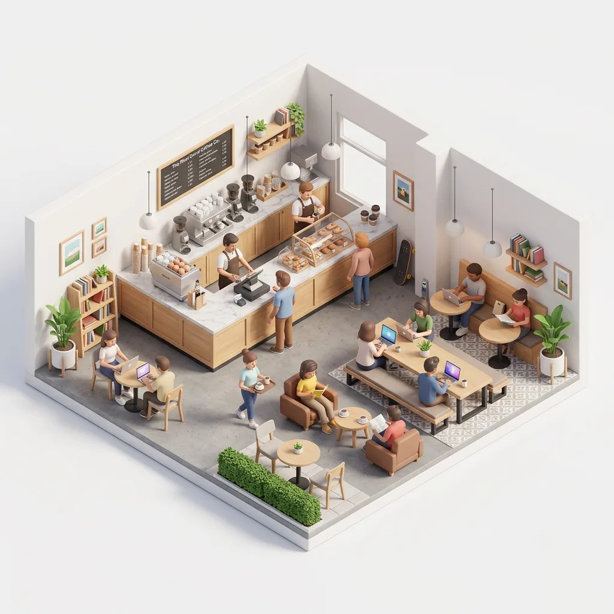

# 45° top-down isometric miniature 3D diorama of SCENE

[← Back to the collection](../../README.md) · Category: [Illustration & 3D](../../gallery/illustration-3d.md) · Model: `Vinano Image Pro` · ID: `vn-00614`

<a href="https://vinano.ai?utm_source=github&utm_medium=readme&utm_campaign=awesome-image-video-prompts-updating&utm_content=prompt-page-image"></a>

<sub>Preview generated with <a href="https://vinano.ai?utm_source=github&utm_medium=readme&utm_campaign=awesome-image-video-prompts-updating&utm_content=prompt-page-caption">vinano.ai</a></sub>

## Prompt

```text
Create a 45° top-down isometric miniature 3D diorama of [SCENE], including all key objects and tiny stylized people interacting naturally the environment.

Composition:
•Include all relevant props, furniture, or items that make the scene recognizable.
•Tiny characters can sit, stand, walk, or interact objects as appropriate.
•Soft realistic lighting, gentle shadows, subtle textures, minimal background.
•Maintain consistent scale, camera angle, perspective, and style.

Visual style: clean, editorial Apple-UI aesthetic, bright yet soft colors, ultra-crisp 3D textures.
Background: solid color Crisp White
Output: 1080×1080, ultra-crisp, social-feed optimized, no watermark.

Preserve realistic proportions and depth for a confident, professional finish.
```

## Try it on vinano.ai

1. Copy the prompt above.
2. Open **[vinano.ai](https://vinano.ai?utm_source=github&utm_medium=readme&utm_campaign=awesome-image-video-prompts-updating&utm_content=prompt-page-try)**, paste it into the image generator and pick a model.
3. Swap any placeholders (brand, product, city, person…) for your own details, then generate.

More prompts like this: [Illustration & 3D gallery](../../gallery/illustration-3d.md) · [all categories](../../README.md#contents)
