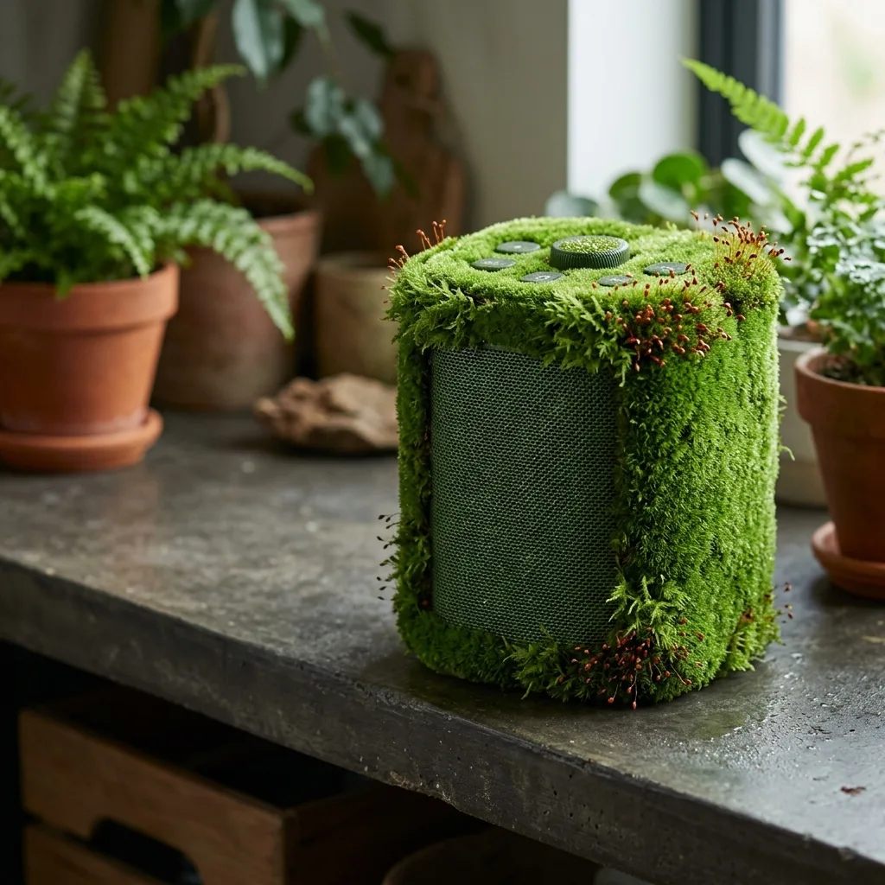

# PRODUCT rendered as if entirely grown from living moss

[← Back to the collection](../../README.md) · Category: [Illustration & 3D](../../gallery/illustration-3d.md) · Model: `Vinano Image v2` · ID: `vn-00616`

<a href="https://vinano.ai?utm_source=github&utm_medium=readme&utm_campaign=awesome-image-video-prompts-updating&utm_content=prompt-page-image"></a>

<sub>Preview generated with <a href="https://vinano.ai?utm_source=github&utm_medium=readme&utm_campaign=awesome-image-video-prompts-updating&utm_content=prompt-page-caption">vinano.ai</a></sub>

## Prompt

```text
A [PRODUCT] rendered as if entirely grown from living moss, perfectly maintaining product form while being undeniably alive and soft. Different moss varieties create texture variation: smooth cushion moss for flat surfaces, feathery fern moss for details, tiny fruiting bodies as accent points. Damp, verdant, breathing. Positioned in a botanical studio setting or against dark earth tones. Biophilic design meets product photography. Soft natural lighting emphasizing the life, the moisture, the green depth. Sharp focus, saturated natural greens, wellness brand aesthetic, ultra-high resolution, the manufactured made living. Aim for an editorial, design-driven look with deliberate negative space.
```

## Try it on vinano.ai

1. Copy the prompt above.
2. Open **[vinano.ai](https://vinano.ai?utm_source=github&utm_medium=readme&utm_campaign=awesome-image-video-prompts-updating&utm_content=prompt-page-try)**, paste it into the image generator and pick a model.
3. Swap any placeholders (brand, product, city, person…) for your own details, then generate.

More prompts like this: [Illustration & 3D gallery](../../gallery/illustration-3d.md) · [all categories](../../README.md#contents)
