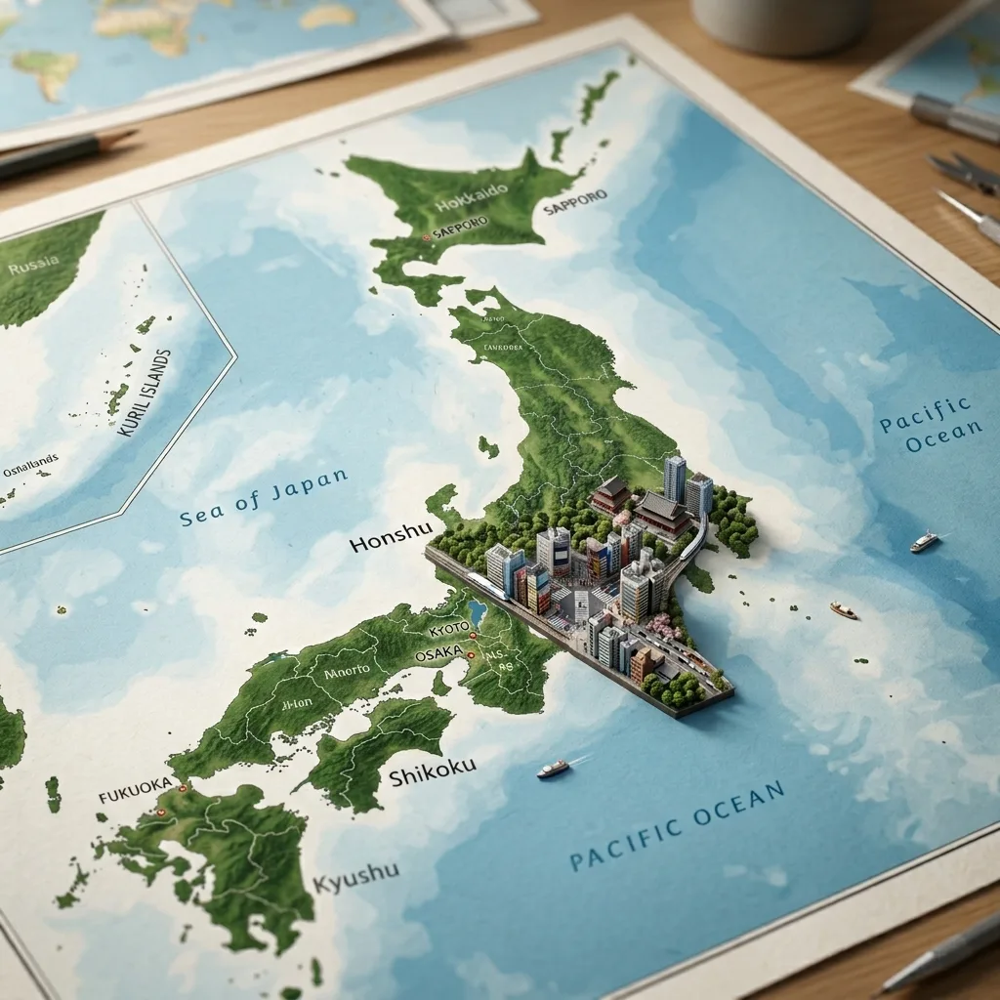

# Top-down geographic map precise cartographic accuracy, clearly defining

[← Back to the collection](../../README.md) · Category: [Illustration & 3D](../../gallery/illustration-3d.md) · Model: `Vinano Image Pro` · ID: `vn-00617`

<a href="https://vinano.ai?utm_source=github&utm_medium=readme&utm_campaign=awesome-image-video-prompts-updating&utm_content=prompt-page-image"></a>

<sub>Preview generated with <a href="https://vinano.ai?utm_source=github&utm_medium=readme&utm_campaign=awesome-image-video-prompts-updating&utm_content=prompt-page-caption">vinano.ai</a></sub>

## Prompt

```text
Ultra-realistic top-down geographic map precise cartographic accuracy, clearly defining the true geographic context of [COUNTRY].

From the exact real-world coordinates of [CITY], a highly detailed miniature 3D diorama rises organically from the map surface, perfectly aligned its true location.

The diorama features iconic architecture, signature natural landmarks, and authentic cultural elements of the city, seamlessly integrated into the map as if sculpted from it.

Physically accurate materials, realistic surface textures, and true-to-scale proportions.

Shallow depth of field macro-lens realism, subtle atmospheric perspective.

Soft neutral studio lighting controlled shadows to enhance depth and realism.

Cinematic composition, premium architectural-model photography style.

Ultra-sharp detail, high dynamic range, true-to-life photorealistic finish.
Square 1:1 format, realistic scale, museum-quality visual output.

Emphasise material texture and natural light so the final frame feels tactile and premium.
```

## Try it on vinano.ai

1. Copy the prompt above.
2. Open **[vinano.ai](https://vinano.ai?utm_source=github&utm_medium=readme&utm_campaign=awesome-image-video-prompts-updating&utm_content=prompt-page-try)**, paste it into the image generator and pick a model.
3. Swap any placeholders (brand, product, city, person…) for your own details, then generate.

More prompts like this: [Illustration & 3D gallery](../../gallery/illustration-3d.md) · [all categories](../../README.md#contents)
