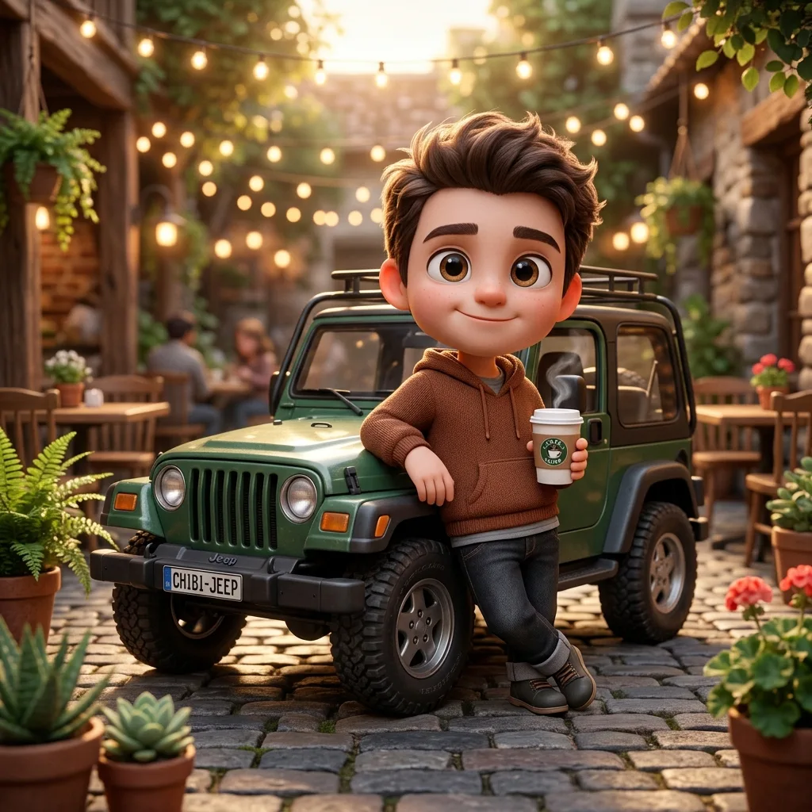

# Ultra-detailed 3D chibi-style character a big head and expressive

[← Back to the collection](../../README.md) · Category: [Illustration & 3D](../../gallery/illustration-3d.md) · Model: `Vinano Image v2` · ID: `vn-00633`

<a href="https://vinano.ai?utm_source=github&utm_medium=readme&utm_campaign=awesome-image-video-prompts-updating&utm_content=prompt-page-image"></a>

<sub>Preview generated with <a href="https://vinano.ai?utm_source=github&utm_medium=readme&utm_campaign=awesome-image-video-prompts-updating&utm_content=prompt-page-caption">vinano.ai</a></sub>

## Prompt

```text
Ultra-detailed 3D chibi-style character a big head and expressive eyes, cute proportions, smooth stylized skin, friendly smile. The character is casually leaning against a small green off-road Jeep, holding a takeaway coffee cup. Cozy outdoor café courtyard setting wooden tables, potted plants, warm string lights in the background. Soft golden-hour lighting, shallow depth of field, cinematic bokeh. premium-quality Pixar-style 3D render, vibrant colors, clean textures, adorable yet realistic character design, professional character illustration, 8K render. Preserve realistic proportions and depth for a confident, professional finish.
```

## Try it on vinano.ai

1. Copy the prompt above.
2. Open **[vinano.ai](https://vinano.ai?utm_source=github&utm_medium=readme&utm_campaign=awesome-image-video-prompts-updating&utm_content=prompt-page-try)**, paste it into the image generator and pick a model.
3. Swap any placeholders (brand, product, city, person…) for your own details, then generate.

More prompts like this: [Illustration & 3D gallery](../../gallery/illustration-3d.md) · [all categories](../../README.md#contents)
