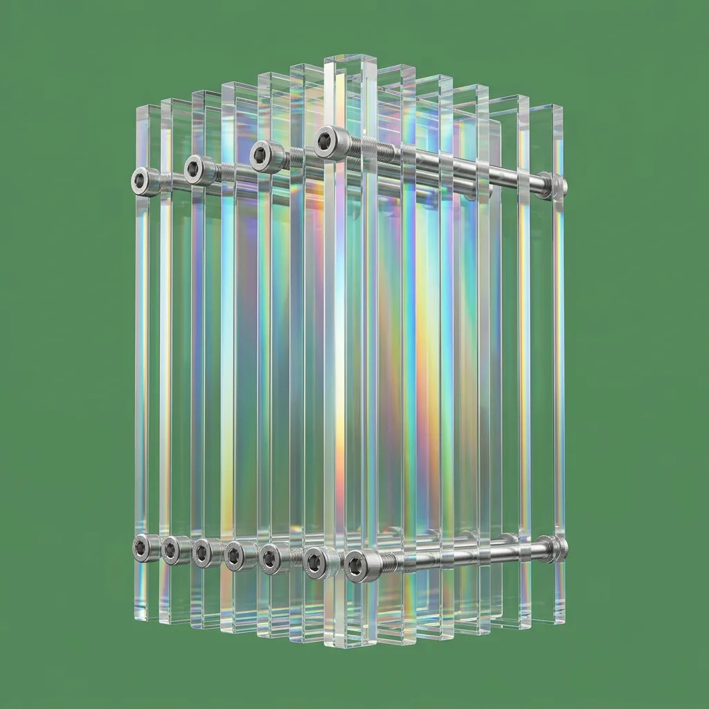

# Wide shot, no cropping, centered full-product view

[← Back to the collection](../../README.md) · Category: [Illustration & 3D](../../gallery/illustration-3d.md) · Model: `Vinano Image Pro` · ID: `vn-00635`

<a href="https://vinano.ai?utm_source=github&utm_medium=readme&utm_campaign=awesome-image-video-prompts-updating&utm_content=prompt-page-image"></a>

<sub>Preview generated with <a href="https://vinano.ai?utm_source=github&utm_medium=readme&utm_campaign=awesome-image-video-prompts-updating&utm_content=prompt-page-caption">vinano.ai</a></sub>

## Prompt

```text
{
 "request": {
 "product": "[PRODUCT HERE]",
 "background_color": "#59925C",
 "style": "prismatic_industrial_minimalism",
 "visual_elements": {
 "structure": "multiple separate vertical acrylic layers forming the product silhouette — each layer is a distinct flat panel visible air gaps between them, like slices of the product spaced apart",
 "material": "high-clarity glass rainbow prismatic iridescent tint",
 "hardware": "stainless steel through-bolts visible internal Allen hexagonal socket heads — bolts pass through all layers front to back, holding them together visible spacing",
 "orientation": "strictly upright vertical placement, full object visibility",
 "lighting": "dispersive spectral highlights and sharp caustics"
 },
 "composition": {
 "frame": "wide shot, no cropping, centered full-product view",
 "camera_angle": "eye-level studio perspective, slightly angled to reveal gaps between layers",
 "depth_of_field": "deep enough to maintain focus on hardware details",
 "background": "seamless solid #59925C background no floor, surface, pedestal, platform, table, shadow ground, or horizon line — the product floats against a uniform single-color field",
 "grounding": "no visible ground plane, no reflective surface beneath the product"
 },
 "rendering_details": {
 "transparency": "multi-layered refraction thin-film interference",
 "finish": "polished edges subtle holographic light dispersion",
 "hardware_detail": "macro-precision on hex-head bolt sockets",
 "layer_direction": "every glass/acrylic layer is strictly vertical — no horizontal slabs, curved shells, or molded forms",
 "layer_separation": "each glass panel must be visibly separated clear air gaps — not fused or touching — bolts are the only element connecting the layers"
 }
 }
}

Emphasise material texture and natural light so the final frame feels tactile and premium.
```

## Try it on vinano.ai

1. Copy the prompt above.
2. Open **[vinano.ai](https://vinano.ai?utm_source=github&utm_medium=readme&utm_campaign=awesome-image-video-prompts-updating&utm_content=prompt-page-try)**, paste it into the image generator and pick a model.
3. Swap any placeholders (brand, product, city, person…) for your own details, then generate.

More prompts like this: [Illustration & 3D gallery](../../gallery/illustration-3d.md) · [all categories](../../README.md#contents)
