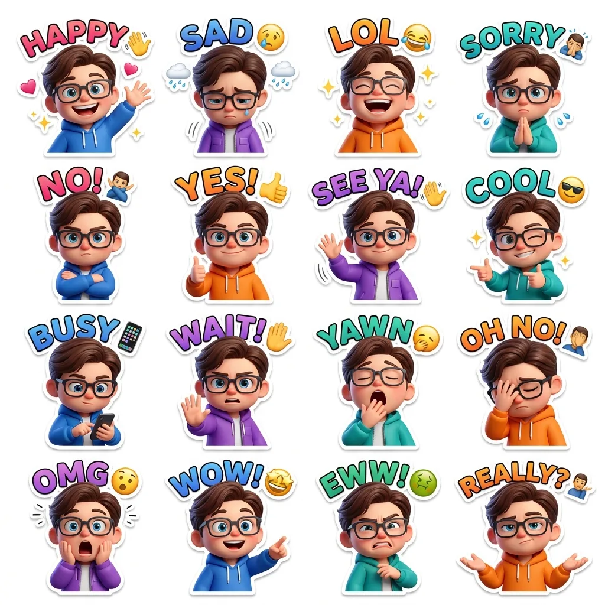

# Premium animated sticker pack , ref image

[← Back to the collection](../../README.md) · Category: [Illustration & 3D](../../gallery/illustration-3d.md) · Model: `Vinano Image Pro` · ID: `vn-00636`

<a href="https://vinano.ai?utm_source=github&utm_medium=readme&utm_campaign=awesome-image-video-prompts-updating&utm_content=prompt-page-image"></a>

<sub>Preview generated with <a href="https://vinano.ai?utm_source=github&utm_medium=readme&utm_campaign=awesome-image-video-prompts-updating&utm_content=prompt-page-caption">vinano.ai</a></sub>

## Prompt

```text
{
 "task": "premium_animated_sticker_pack",
 "ref_image": "use_only_uploaded_identity_preserve_all_features",
 "format": { "grid": "4x4", "count": 16, "aspect": "2:3", "spacing": "clean", "alignment": "perfect", "bg": "white" },
 "style": {
 "character": "chibi_65_70_head_dynamic_pose_rounded_expressive",
 "render": "high_end_3D_pixar_quality",
 "outline": "white_stroke"
 },
 "clothing": {
 "type": "modern_streetwear",
 "items": ["hoodies","jackets"],
 "colors": ["blue","purple","orange","teal"],
 "variation": "slight_consistent"
 },
 "text": {
 "placement": "top",
 "style": "bold_curved_gradient",
 "effects": ["white_outline","shadow","emoji"]
 },
 "stickers": [["HAPPY","wave"], ["SAD","down"], ["LOL","laugh"], ["SORRY","hands_together"],
 ["NO!","cross_arms"], ["YES!","thumbs_up"], ["SEE YA!","bye"], ["COOL","finger_guns"],
 ["BUSY","phone"], ["WAIT!","stop"], ["YAWN","sleepy"], ["OH NO!","facepalm"],
 ["OMG","shock"], ["WOW!","point"], ["EWW!","disgust"], ["REALLY?","shrug"]],
 "lighting": "soft_studio_rim_light_bright_clean",
 "extras": ["sparkles","hearts","sweat","motion_lines"],
 "consistency": "same_identity_face_glasses_grooming_quality_proportions",
 "negative": "no_mismatch_no_identity_change_no_realistic_body_no_stiff_no_dull_no_overlap_no_bad_hands_no_blur_no_low_quality_no_inconsistent_no_watermark"
}

Preserve realistic proportions and depth for a confident, professional finish.
```

## Try it on vinano.ai

1. Copy the prompt above.
2. Open **[vinano.ai](https://vinano.ai?utm_source=github&utm_medium=readme&utm_campaign=awesome-image-video-prompts-updating&utm_content=prompt-page-try)**, paste it into the image generator and pick a model.
3. Swap any placeholders (brand, product, city, person…) for your own details, then generate.

More prompts like this: [Illustration & 3D gallery](../../gallery/illustration-3d.md) · [all categories](../../README.md#contents)
