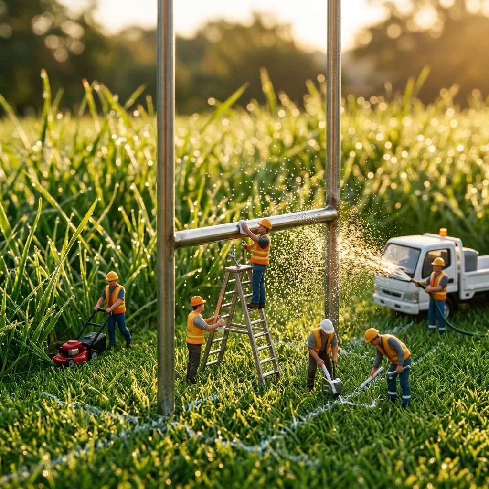

# Macro photography of miniature construction workers working inside

[← Back to the collection](../../README.md) · Category: [Illustration & 3D](../../gallery/illustration-3d.md) · Model: `Vinano Image Pro` · ID: `vn-00639`

<a href="https://vinano.ai?utm_source=github&utm_medium=readme&utm_campaign=awesome-image-video-prompts-updating&utm_content=prompt-page-image"></a>

<sub>Preview generated with <a href="https://vinano.ai?utm_source=github&utm_medium=readme&utm_campaign=awesome-image-video-prompts-updating&utm_content=prompt-page-caption">vinano.ai</a></sub>

## Prompt

```text
{
 "prompt": "Ultra-realistic macro photography of miniature construction workers working inside a lush green grass field at golden hour. Tiny workers wearing safety helmets and reflective orange-yellow vests are installing and cleaning a large metallic rugby goal post structure emerging from the grass. One worker is spraying water from a hose connected to a small white utility truck parked in the background, visible water droplets sparkling in sunlight. Another worker is pushing a small lawn mower trimming grass. Two workers are standing on metal ladders adjusting and polishing the horizontal bar of the goal post. Additional workers are cleaning grass lines tools, creating white chalk field markings across the grass. Dew drops on grass blades glowing soft bokeh in background. Extremely shallow depth of field, filmic, cinematic lighting, warm natural sunlight, high detail textures, realistic metal reflections, soft background blur, tilt-shift effect, 8K resolution, professional macro lens photography, hyper-realistic miniature diorama style.",
 "negative_prompt": "blurry, low resolution, cartoon style, CGI look, unrealistic proportions, oversaturated colors, harsh shadows, distorted anatomy, messy composition, noisy image, watermark, text, logo",
 "settings": {
 "resolution": "1024x1024",
 "lighting": "golden hour natural sunlight",
 "camera": "macro lens 100mm",
 "depth_of_field": "very shallow",
 "style": "true-to-life photorealistic miniature diorama",
 "quality": "ultra high detail",
 "aspect_ratio": "1:1"
 }
}

Emphasise material texture and natural light so the final frame feels tactile and premium.
```

## Try it on vinano.ai

1. Copy the prompt above.
2. Open **[vinano.ai](https://vinano.ai?utm_source=github&utm_medium=readme&utm_campaign=awesome-image-video-prompts-updating&utm_content=prompt-page-try)**, paste it into the image generator and pick a model.
3. Swap any placeholders (brand, product, city, person…) for your own details, then generate.

More prompts like this: [Illustration & 3D gallery](../../gallery/illustration-3d.md) · [all categories](../../README.md#contents)
