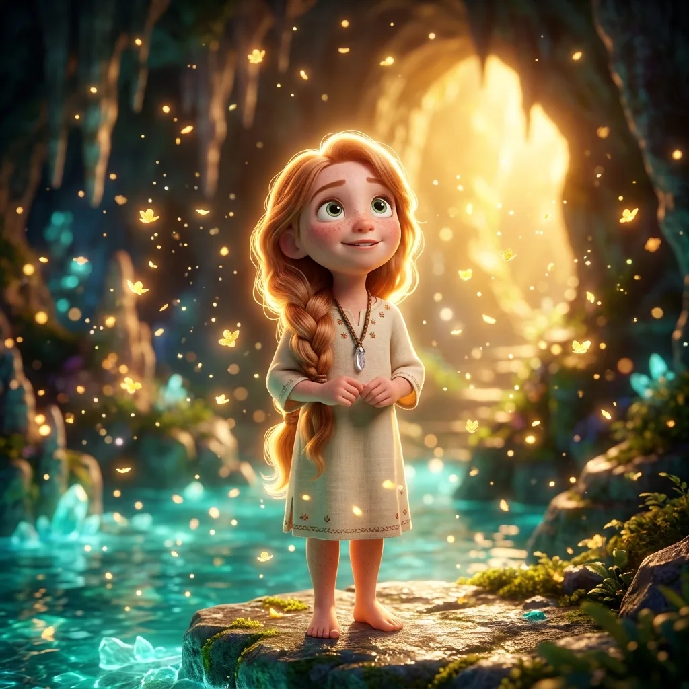

# Dreamy, cinematic 3D animated girl big expressive eyes

[← Back to the collection](../../README.md) · Category: [Illustration & 3D](../../gallery/illustration-3d.md) · Model: `Vinano Image v2` · ID: `vn-00661`

<a href="https://vinano.ai?utm_source=github&utm_medium=readme&utm_campaign=awesome-image-video-prompts-updating&utm_content=prompt-page-image"></a>

<sub>Preview generated with <a href="https://vinano.ai?utm_source=github&utm_medium=readme&utm_campaign=awesome-image-video-prompts-updating&utm_content=prompt-page-caption">vinano.ai</a></sub>

## Prompt

```text
A dreamy, cinematic 3D animated girl big expressive eyes and soft freckles, warm golden backlighting, long wavy strawberry-blonde hair in a loose braid glowing in the sunlight, standing inside a magical cave turquoise water, surrounded by floating glowing golden flower petals and light particles, soft bokeh background, gentle smile looking upward in wonder, warm pastel color palette, volumetric lighting, shallow depth of field, ultra-detailed, premium quality, pixar / disney inspired style, fantasy atmosphere, soft focus, glowing rim light, cinematic composition, 8k, highly detailed, whimsical, ethereal lighting. Render with rich micro-detail while keeping the layout uncluttered and intentional.
```

## Try it on vinano.ai

1. Copy the prompt above.
2. Open **[vinano.ai](https://vinano.ai?utm_source=github&utm_medium=readme&utm_campaign=awesome-image-video-prompts-updating&utm_content=prompt-page-try)**, paste it into the image generator and pick a model.
3. Swap any placeholders (brand, product, city, person…) for your own details, then generate.

More prompts like this: [Illustration & 3D gallery](../../gallery/illustration-3d.md) · [all categories](../../README.md#contents)
