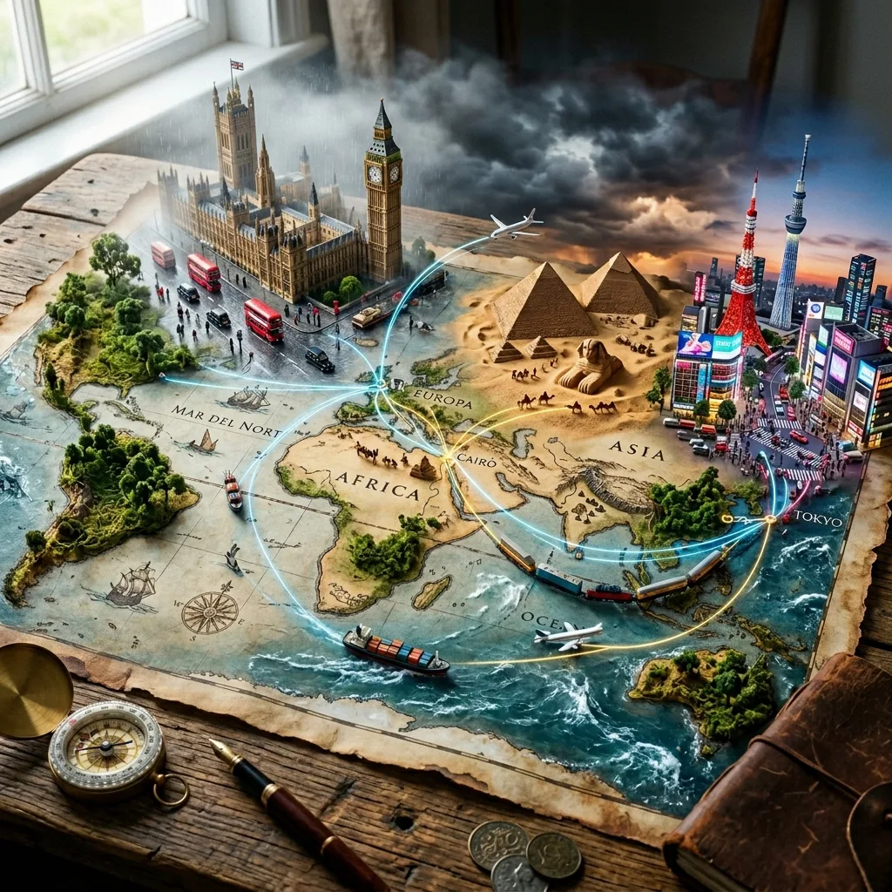

# Weathered MAP TYPE map spread across SURFACE , bursting

[← Back to the collection](../../README.md) · Category: [Illustration & 3D](../../gallery/illustration-3d.md) · Model: `Vinano Image Pro` · ID: `vn-00690`

<a href="https://vinano.ai?utm_source=github&utm_medium=readme&utm_campaign=awesome-image-video-prompts-updating&utm_content=prompt-page-image"></a>

<sub>Preview generated with <a href="https://vinano.ai?utm_source=github&utm_medium=readme&utm_campaign=awesome-image-video-prompts-updating&utm_content=prompt-page-caption">vinano.ai</a></sub>

## Prompt

```text
A weathered {MAP_TYPE} map spread across {SURFACE}, bursting true-to-life photorealistic miniature worlds erupting from marked locations. {CITY_1} explodes from {CONTINENT} as a living diorama—{LANDMARK_1} towers above {STREET_SCENE}, surrounded by {ATMOSPHERIC_EFFECT} and {MOVING_ELEMENT}. {CITY_2} rises from {CONTINENT} {LANDMARK_2} emerging through {WEATHER_DRAMA}, tiny {LOCAL_ACTIVITY} frozen mid-motion. {CITY_3} materializes from {CONTINENT} where {LANDMARK_3} pierces through {LIGHTING_EFFECT}, {CULTURAL_DETAIL} spilling across miniature streets. Connecting routes glow as {VISUAL_ELEMENT}—miniature {VEHICLE_TYPE} suspended impossibly between worlds. The map's surface transitions from flat parchment to living terrain: oceans become actual churning water {WATER_DETAIL}, deserts shimmer real heat haze, forests sprout miniature trees. Each city exists in its own time: {LIGHTING_CONDITION_1} bathes one, {LIGHTING_CONDITION_2} illuminates another, {LIGHTING_CONDITION_3} glows over the third. {FOREGROUND_OBJECTS} scatter around the map edges. {PHOTOGRAPHY_STYLE}, {COLOR_PALETTE}, extreme depth of field, 8K, {ERA_AESTHETIC} meets magical realism. Emphasise material texture and natural light so the final frame feels tactile and premium.
```

## Try it on vinano.ai

1. Copy the prompt above.
2. Open **[vinano.ai](https://vinano.ai?utm_source=github&utm_medium=readme&utm_campaign=awesome-image-video-prompts-updating&utm_content=prompt-page-try)**, paste it into the image generator and pick a model.
3. Swap any placeholders (brand, product, city, person…) for your own details, then generate.

More prompts like this: [Illustration & 3D gallery](../../gallery/illustration-3d.md) · [all categories](../../README.md#contents)
