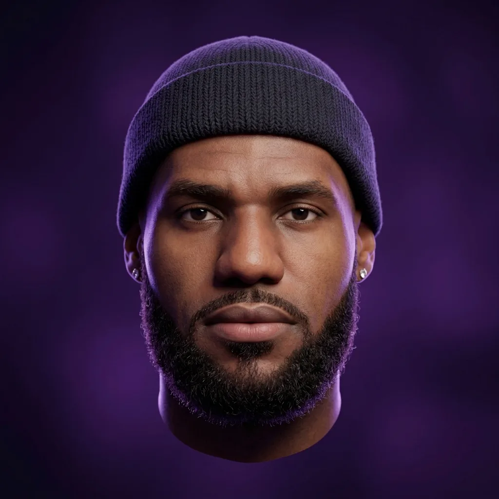

# Ultra-detailed stylized 3D portrait the provided reference photo lebron

[← Back to the collection](../../README.md) · Category: [Illustration & 3D](../../gallery/illustration-3d.md) · Model: `Vinano Image Pro` · ID: `vn-00712`

<a href="https://vinano.ai?utm_source=github&utm_medium=readme&utm_campaign=awesome-image-video-prompts-updating&utm_content=prompt-page-image"></a>

<sub>Preview generated with <a href="https://vinano.ai?utm_source=github&utm_medium=readme&utm_campaign=awesome-image-video-prompts-updating&utm_content=prompt-page-caption">vinano.ai</a></sub>

## Prompt

```text
Ultra-detailed stylized 3D portrait the provided reference photo lebron james as the exact facial base.
Preserve the person perfectly — identical face shape, bone structure, jawline, eyes, nose, lips, skin tone, marks, freckles, expression and proportions.
DO NOT modify facial identity in any way.
Convert ONLY into high-end stylized 3D realism.
Head & elements:
Floating head only (no neck, no shoulders, no body)
Keep EXACTLY whatever the person has on their head in the reference image — same hairstyle, same hair length and texture, same hat, cap, sunglasses, glasses, headphones or any accessory. Do not remove or add anything.
Skin refinement:
Natural smooth skin (not plastic).Visible realistic micro-texture and pores. Subtle subsurface scattering for natural light diffusion. Soft highlights on cheekbones, nose bridge and tip.Balanced realistic shadows for depth
Hair & accessories (if present in reference):
Ultra-realistic volumetric strands.Natural shine and soft rim reflections. Perfectly preserved shape and position
Lighting:
Strong cinematic purple ambient background. Soft frontal key light evenly illuminating the face. Subtle rim light separating head from background. Gentle under-chin shadow for depth. Smooth light gradients, no harsh contrast
Rendering style:
Premium Pixar-quality stylized realism. Clean smooth shading. Global illumination. Soft bloom on highlights. Ultra sharp edgesNoise-free professional CGI
Camera & quality:
Centered portrait composition. Shallow depth of field illusion. Ultra high resolution. Cinematic look
Rules:
Respect reference face 100%.Respect all head accessories and hair exactly. Only convert to stylized 3D. No exaggeration. No cartoon distortion. No facial changes

Maintain consistent colour harmony and crisp focus across the whole frame.
```

## Try it on vinano.ai

1. Copy the prompt above.
2. Open **[vinano.ai](https://vinano.ai?utm_source=github&utm_medium=readme&utm_campaign=awesome-image-video-prompts-updating&utm_content=prompt-page-try)**, paste it into the image generator and pick a model.
3. Swap any placeholders (brand, product, city, person…) for your own details, then generate.

More prompts like this: [Illustration & 3D gallery](../../gallery/illustration-3d.md) · [all categories](../../README.md#contents)
