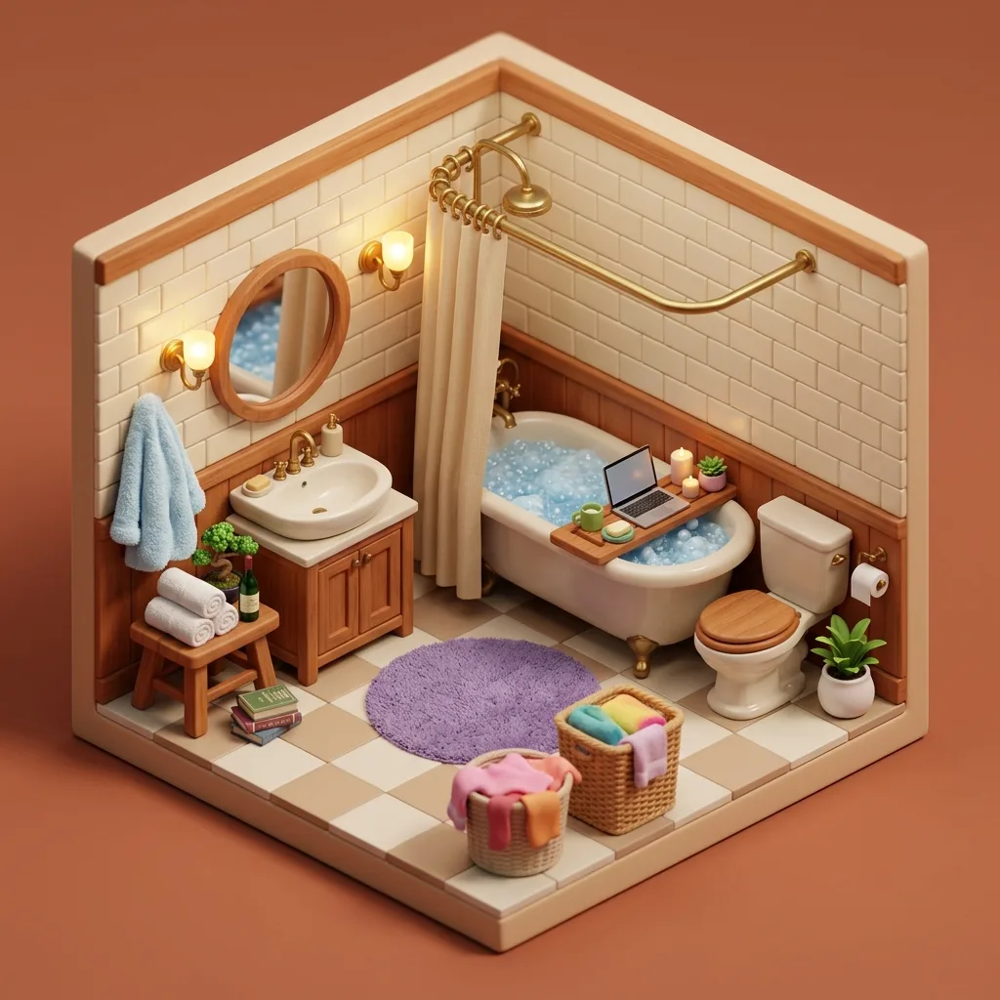

# Cute cozy isometric 3D miniature bathroom diorama, warm cozy

[← Back to the collection](../../README.md) · Category: [Illustration & 3D](../../gallery/illustration-3d.md) · Model: `Vinano Image Pro` · ID: `vn-00719`

<a href="https://vinano.ai?utm_source=github&utm_medium=readme&utm_campaign=awesome-image-video-prompts-updating&utm_content=prompt-page-image"></a>

<sub>Preview generated with <a href="https://vinano.ai?utm_source=github&utm_medium=readme&utm_campaign=awesome-image-video-prompts-updating&utm_content=prompt-page-caption">vinano.ai</a></sub>

## Prompt

```text
{
 "prompt": "cute cozy isometric 3D miniature bathroom diorama, warm cozy aesthetic, detailed tiny room corner view, warm terracotta and beige color palette, small japanese-style bathroom scene, cream ceramic subway tiles warm wooden trim, vintage clawfoot bathtub filled blue bubbly foam, wooden bath tray across tub open laptop, green mug, soap, candles, small potted plant, golden brass curved shower rod beige shower curtain, round wooden mirror, white porcelain sink wooden vanity cabinet, brass faucet, toilet wooden seat, small wooden stool rolled white towels and books, green wine bottle, tiny bonsai plant, wall mounted gold sconces warm glowing bulbs, light blue fluffy towel hanging on wall hook, laundry basket pink and orange clothes, wicker laundry hamper full of colorful towels, round plush purple bath mat, checkered beige-white floor tiles, small potted plant in white pot, cozy warm lighting, soft shadows, extremely detailed miniature dollhouse style, warm inviting atmosphere, soft bokeh, ken follett miniature aesthetic, tilt-shift effect, 8k, hyperdetailed, trending on artstation",
 "negative_prompt": "blurry, low quality, realistic scale, huge objects, people, human figures, text, watermark, logo, overexposed, underexposed, modern chrome, cold blue lighting, hospital style, empty room, cartoon, anime, 2D, sketch, painting, drawing",
 "aspect_ratio": "4:3",
 "style": "miniature diorama, isometric, cozy interior, warm tones, detailed product photography",
 "lighting": "soft warm golden hour lighting, cozy ambient glow, practical light sources from sconces",
 "camera_angle": "isometric 45 degree corner view, looking down into the room corner, miniature photography style",
 "quality_tags": "masterpiece, best quality, ultra detailed, 8k, sharp focus, intricate details",
 "additional_weights": {
 "miniature": 1.3,
 "diorama": 1.4,
 "isometric": 1.35,
 "cozy": 1.25,
 "warm lighting": 1.2,
 "detailed textures": 1.3
 }
}

Maintain consistent colour harmony and crisp focus across the whole frame.
```

## Try it on vinano.ai

1. Copy the prompt above.
2. Open **[vinano.ai](https://vinano.ai?utm_source=github&utm_medium=readme&utm_campaign=awesome-image-video-prompts-updating&utm_content=prompt-page-try)**, paste it into the image generator and pick a model.
3. Swap any placeholders (brand, product, city, person…) for your own details, then generate.

More prompts like this: [Illustration & 3D gallery](../../gallery/illustration-3d.md) · [all categories](../../README.md#contents)
