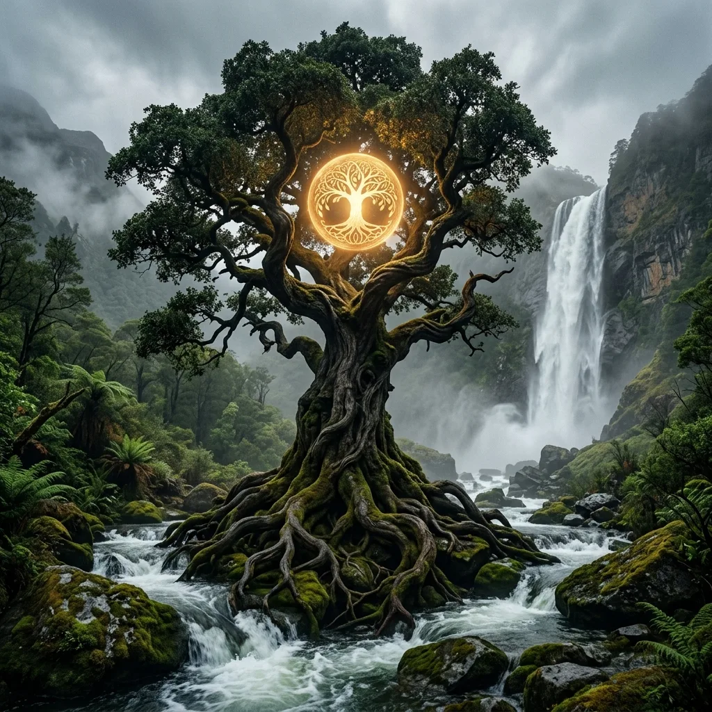

# Majestic, ancient gnarled tree thick, twisting roots sits

[← Back to the collection](../../README.md) · Category: [Illustration & 3D](../../gallery/illustration-3d.md) · Model: `Vinano Image v2` · ID: `vn-00738`

<a href="https://vinano.ai?utm_source=github&utm_medium=readme&utm_campaign=awesome-image-video-prompts-updating&utm_content=prompt-page-image"></a>

<sub>Preview generated with <a href="https://vinano.ai?utm_source=github&utm_medium=readme&utm_campaign=awesome-image-video-prompts-updating&utm_content=prompt-page-caption">vinano.ai</a></sub>

## Prompt

```text
A majestic, ancient gnarled tree thick, twisting roots sits at the center of a lush, mystical landscape, its roots anchoring into a vibrant, foaming stream flowing over moss-covered rocks. Suspended within the dense, dark green canopy of the tree is a radiant, glowing golden orb containing a detailed, ethereal silhouette of a tree of life. In the background, a massive, towering waterfall cascades down a rugged, misty cliffside into the river below. The scene is illuminated by the soft, warm light emanating from the golden orb, contrasting the moody, overcast sky and the deep, rich greens of the surrounding forest. true-to-life photorealistic, filmic, cinematic lighting, high fantasy art style, intricate textures on the bark and water, 8k resolution. Keep edges clean and the overall composition balanced for a polished, gallery-ready result.
```

## Try it on vinano.ai

1. Copy the prompt above.
2. Open **[vinano.ai](https://vinano.ai?utm_source=github&utm_medium=readme&utm_campaign=awesome-image-video-prompts-updating&utm_content=prompt-page-try)**, paste it into the image generator and pick a model.
3. Swap any placeholders (brand, product, city, person…) for your own details, then generate.

More prompts like this: [Illustration & 3D gallery](../../gallery/illustration-3d.md) · [all categories](../../README.md#contents)
