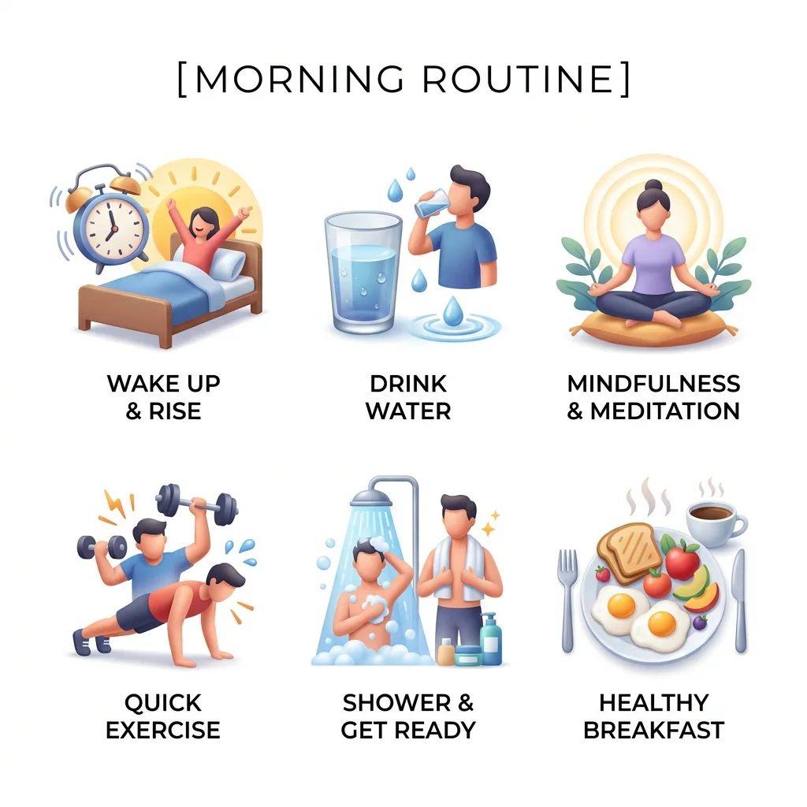

# Collection of icons representing ROUTINE / PROCESS / HABITS

[← Back to the collection](../../README.md) · Category: [Illustration & 3D](../../gallery/illustration-3d.md) · Model: `Vinano Image Pro` · ID: `vn-00746`

<a href="https://vinano.ai?utm_source=github&utm_medium=readme&utm_campaign=awesome-image-video-prompts-updating&utm_content=prompt-page-image"></a>

<sub>Preview generated with <a href="https://vinano.ai?utm_source=github&utm_medium=readme&utm_campaign=awesome-image-video-prompts-updating&utm_content=prompt-page-caption">vinano.ai</a></sub>

## Prompt

```text
Create a collection of icons representing [ROUTINE / PROCESS / HABITS], each icon depicting one specific routine step and clearly labeled by name.

They belong together as a single cohesive theme. The background is pure white.

Place the title “[ROUTINE NAME]” at the top center of the image, aligned symmetrically above the grid, a clean, minimal typography style that complements the icon design without overpowering it.
Icons are rendered in a friendly, modern 3D style, featuring smooth gradients and soft shadows.

Maintain consistent proportions, color harmony, materials, and typography across all icons and labels so the set feels unified and easy to read.

Preserve realistic proportions and depth for a confident, professional finish.
```

## Try it on vinano.ai

1. Copy the prompt above.
2. Open **[vinano.ai](https://vinano.ai?utm_source=github&utm_medium=readme&utm_campaign=awesome-image-video-prompts-updating&utm_content=prompt-page-try)**, paste it into the image generator and pick a model.
3. Swap any placeholders (brand, product, city, person…) for your own details, then generate.

More prompts like this: [Illustration & 3D gallery](../../gallery/illustration-3d.md) · [all categories](../../README.md#contents)
