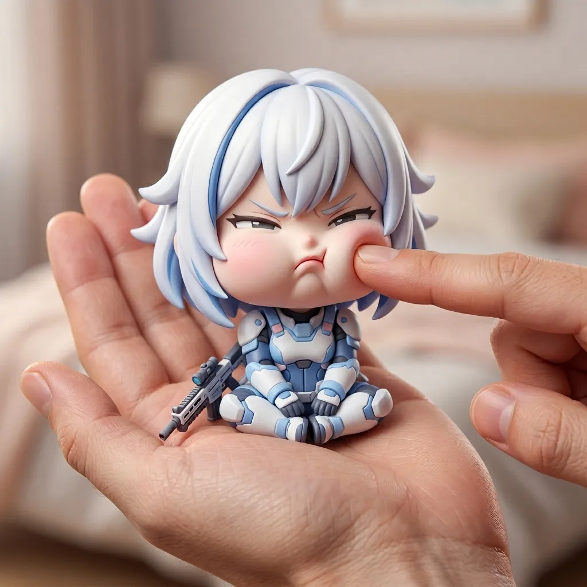

# Mini chibi version of the character in the uploaded

[← Back to the collection](../../README.md) · Category: [Illustration & 3D](../../gallery/illustration-3d.md) · Model: `Vinano Image v2` · ID: `vn-00762`

<a href="https://vinano.ai?utm_source=github&utm_medium=readme&utm_campaign=awesome-image-video-prompts-updating&utm_content=prompt-page-image"></a>

<sub>Preview generated with <a href="https://vinano.ai?utm_source=github&utm_medium=readme&utm_campaign=awesome-image-video-prompts-updating&utm_content=prompt-page-caption">vinano.ai</a></sub>

## Prompt

```text
A mini chibi version of the character in the uploaded image, a big head and small body, sitting on an open left palm for realistic scale. A right hand gently pressing its cheek an index finger. The character looks annoyed and pouty — puffed cheeks, slightly frowning, squinting eyes. Ultra-detailed chibi style, soft pastel colors, smooth texture, clean lighting, shallow depth of field, strong focus on facial expression and hand interaction, vertical composition 4:5 ratio.​​​​​​​​​​​​​​​​ Preserve realistic proportions and depth for a confident, professional finish.
```

## Try it on vinano.ai

1. Copy the prompt above.
2. Open **[vinano.ai](https://vinano.ai?utm_source=github&utm_medium=readme&utm_campaign=awesome-image-video-prompts-updating&utm_content=prompt-page-try)**, paste it into the image generator and pick a model.
3. Swap any placeholders (brand, product, city, person…) for your own details, then generate.

More prompts like this: [Illustration & 3D gallery](../../gallery/illustration-3d.md) · [all categories](../../README.md#contents)
