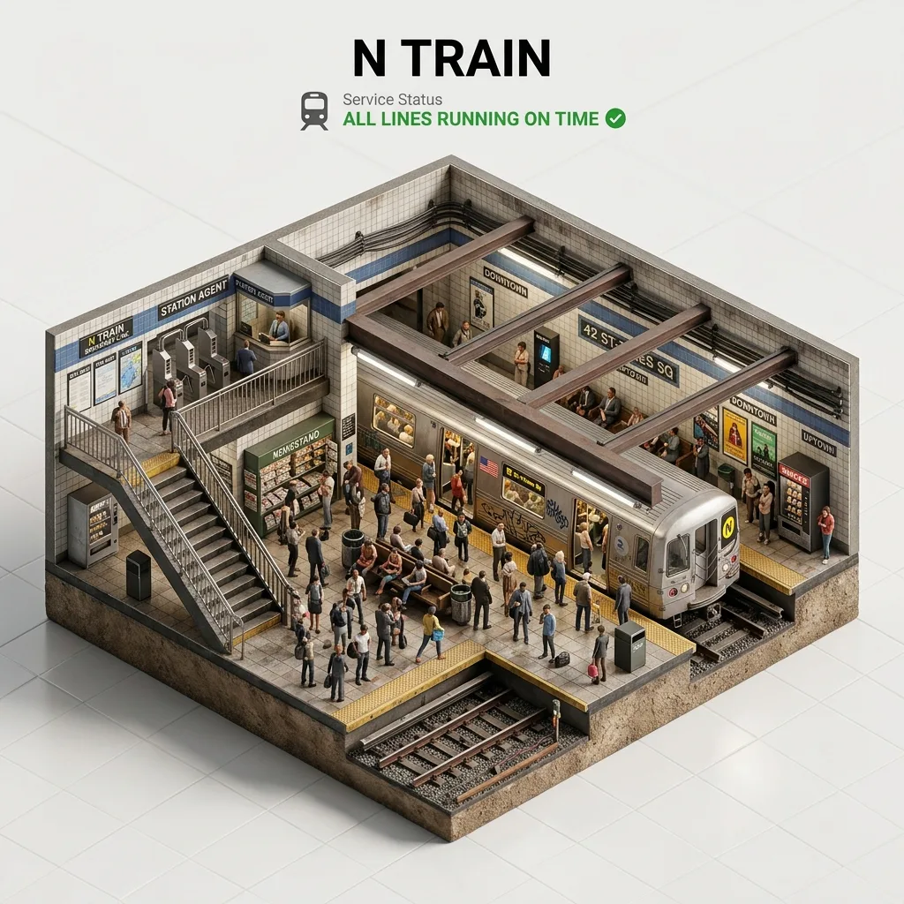

# Scene includes stylized diorama elements such as platforms, miniature

[← Back to the collection](../../README.md) · Category: [Illustration & 3D](../../gallery/illustration-3d.md) · Model: `Vinano Image Pro` · ID: `vn-00788`

<a href="https://vinano.ai?utm_source=github&utm_medium=readme&utm_campaign=awesome-image-video-prompts-updating&utm_content=prompt-page-image"></a>

<sub>Preview generated with <a href="https://vinano.ai?utm_source=github&utm_medium=readme&utm_campaign=awesome-image-video-prompts-updating&utm_content=prompt-page-caption">vinano.ai</a></sub>

## Prompt

```text
8K Ultra-Realistic Promotional
Present a clear, 45° top-down isometric miniature 3D scene of the [SUBWAY SYSTEM / LINE NAME]. The scene includes stylized diorama elements such as platforms, miniature trains, stairwells, signage, tiled walls, vending machines, and people waiting.
Use soft, refined textures, realistic PBR materials, and lifelike lighting subtle shadows to enhance dimensional clarity.
At the top center, place the title “[LINE NAME]” in bold sans-serif text. Below it, add a train icon followed by “Service Status” (small text) and “[STATUS MESSAGE]” red medium text for delays or green for on-time service.
Use a soft, solid tile white background for clarity. Clean, centered, editorial infographic style.
Square format 1080×1080, ultra-detailed 3D render, miniature realism, 8K look, image size 1: 1

Render with rich micro-detail while keeping the layout uncluttered and intentional.
```

## Try it on vinano.ai

1. Copy the prompt above.
2. Open **[vinano.ai](https://vinano.ai?utm_source=github&utm_medium=readme&utm_campaign=awesome-image-video-prompts-updating&utm_content=prompt-page-try)**, paste it into the image generator and pick a model.
3. Swap any placeholders (brand, product, city, person…) for your own details, then generate.

More prompts like this: [Illustration & 3D gallery](../../gallery/illustration-3d.md) · [all categories](../../README.md#contents)
