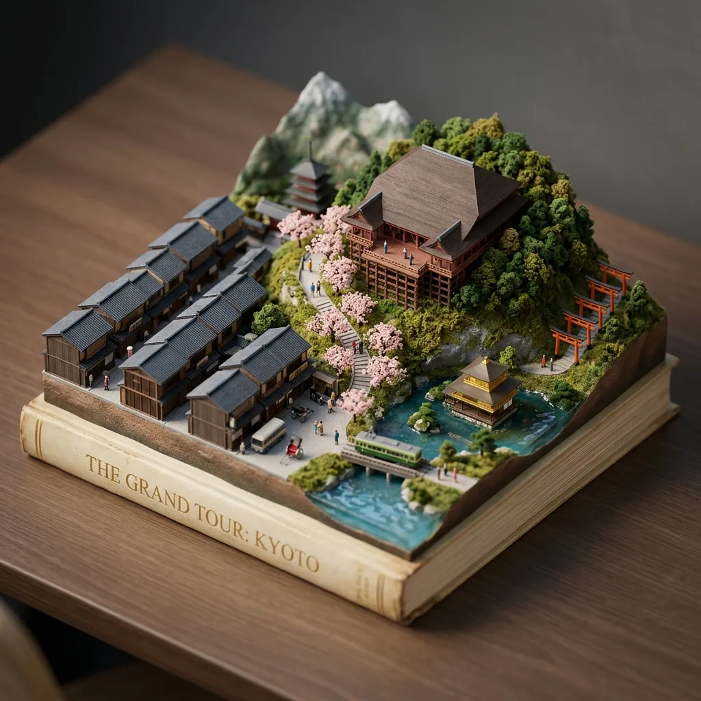

# Stylized miniature 3D diorama viewed from a 45-degree angled

[← Back to the collection](../../README.md) · Category: [Illustration & 3D](../../gallery/illustration-3d.md) · Model: `Vinano Image Pro` · ID: `vn-00791`

<a href="https://vinano.ai?utm_source=github&utm_medium=readme&utm_campaign=awesome-image-video-prompts-updating&utm_content=prompt-page-image"></a>

<sub>Preview generated with <a href="https://vinano.ai?utm_source=github&utm_medium=readme&utm_campaign=awesome-image-video-prompts-updating&utm_content=prompt-page-caption">vinano.ai</a></sub>

## Prompt

```text
Create a stylized miniature 3D diorama viewed from a 45-degree angled perspective, emphasizing careful scale, clean geometry, and fine craftsmanship.

A [OBJECT] serves as the central base of the composition. From within or above this object, a miniature interpretation of [LOCATION NAME] emerges naturally, forming a compact, self-contained world.

The scene highlights recognizable landmarks, terrain features, or symbolic structures associated [LOCATION NAME], arranged harmoniously and rendered precise detail.

Miniature roads, paths, or environmental elements flow through the scene, tiny vehicles, figures, or subtle motion cues adding realism and life.

Use filmic, cinematic lighting, soft highlights, and selective depth-of-field blur to create a magical, dreamlike atmosphere.

Balance playful isometric styling realistic materials and lighting, achieving a polished, premium diorama look.

Highly detailed, cohesive composition an 8K cinematic finish, refined miniature-world aesthetic.

Maintain consistent colour harmony and crisp focus across the whole frame.
```

## Try it on vinano.ai

1. Copy the prompt above.
2. Open **[vinano.ai](https://vinano.ai?utm_source=github&utm_medium=readme&utm_campaign=awesome-image-video-prompts-updating&utm_content=prompt-page-try)**, paste it into the image generator and pick a model.
3. Swap any placeholders (brand, product, city, person…) for your own details, then generate.

More prompts like this: [Illustration & 3D gallery](../../gallery/illustration-3d.md) · [all categories](../../README.md#contents)
