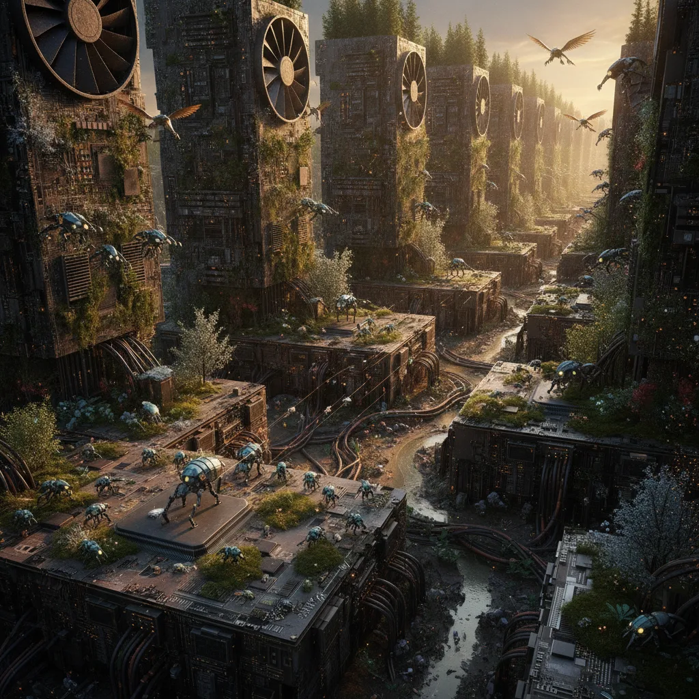

# Colossal OBJECT reimagined as a complete natural biome

[← Back to the collection](../../README.md) · Category: [Illustration & 3D](../../gallery/illustration-3d.md) · Model: `Vinano Image` · ID: `vn-00809`

<a href="https://vinano.ai?utm_source=github&utm_medium=readme&utm_campaign=awesome-image-video-prompts-updating&utm_content=prompt-page-image"></a>

<sub>Preview generated with <a href="https://vinano.ai?utm_source=github&utm_medium=readme&utm_campaign=awesome-image-video-prompts-updating&utm_content=prompt-page-caption">vinano.ai</a></sub>

## Prompt

```text
A colossal [OBJECT] reimagined as a complete natural biome. Tiny [WILDLIFE] has evolved to inhabit every niche the object provides. Predators hunt across its surfaces, herbivores graze in its cavities, birds nest in its heights, insects swarm its crevices. Food chains have formed around the object's geometry. Migration patterns follow its contours. Seasonal changes affect different zones. The object's materials have weathered into naturalistic terrain while remaining recognizable. Documentary aesthetic, golden wildlife lighting, the manufactured as wilderness. Render with rich micro-detail while keeping the layout uncluttered and intentional.
```

## Try it on vinano.ai

1. Copy the prompt above.
2. Open **[vinano.ai](https://vinano.ai?utm_source=github&utm_medium=readme&utm_campaign=awesome-image-video-prompts-updating&utm_content=prompt-page-try)**, paste it into the image generator and pick a model.
3. Swap any placeholders (brand, product, city, person…) for your own details, then generate.

More prompts like this: [Illustration & 3D gallery](../../gallery/illustration-3d.md) · [all categories](../../README.md#contents)
