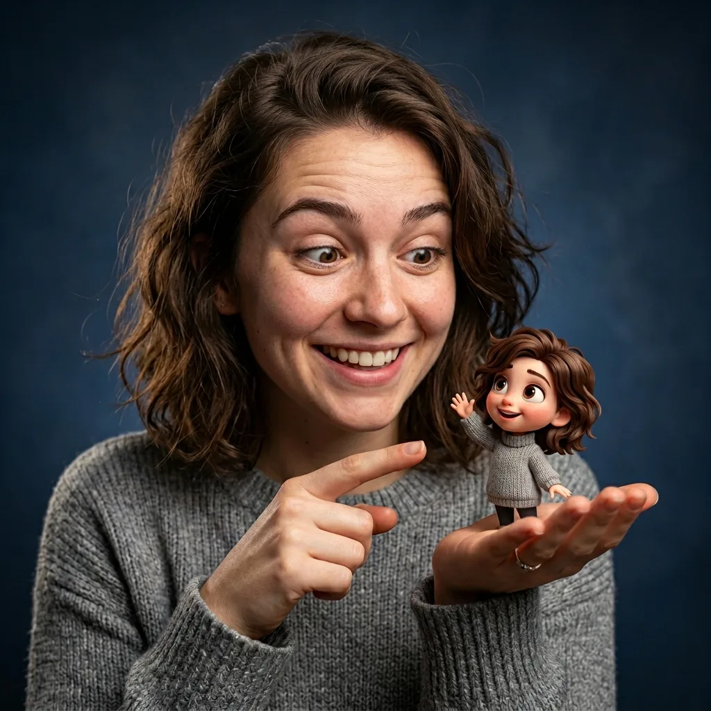

# Medium close-up studio portrait

[← Back to the collection](../../README.md) · Category: [Illustration & 3D](../../gallery/illustration-3d.md) · Model: `Vinano Image v2` · ID: `vn-00818`

<a href="https://vinano.ai?utm_source=github&utm_medium=readme&utm_campaign=awesome-image-video-prompts-updating&utm_content=prompt-page-image"></a>

<sub>Preview generated with <a href="https://vinano.ai?utm_source=github&utm_medium=readme&utm_campaign=awesome-image-video-prompts-updating&utm_content=prompt-page-caption">vinano.ai</a></sub>

## Prompt

```text
{
 "Objective": "Create a studio portrait blending a real human a tiny Pixar-style 3D cartoon version of themselves in a playful, whimsical interaction",
 "PersonaDetails": {
 "PrimarySubject": {
 "Type": "Real human",
 "Wardrobe": "Casual grey sweater or t-shirt",
 "Expression": "Surprised and delighted",
 "Pose": "Holding a tiny character in one hand and pointing at it the other",
 "Skin": "true-to-life photorealistic skin texture natural detail"
 },
 "SecondarySubject": {
 "Type": "Tiny 3D cartoon version of the human",
 "Scale": "Miniature, resting in the human’s hand",
 "Style": "Pixar-style 3D character",
 "Proportions": "Exaggerated cute proportions rounded features",
 "FacialFeatures": {
 "Eyes": "Large, expressive",
 "Expression": "Friendly, playful"
 },
 "Consistency": "Matching hairstyle and outfit of the real human"
 }
 },
 "Composition": {
 "Framing": "Medium close-up studio portrait",
 "InteractionFocus": "Clear visual relationship between human and miniature character",
 "DepthOfField": "Shallow depth of field",
 "Focus": "Ultra-sharp focus on both faces"
 },
 "LightingAndBackground": {
 "LightingStyle": "Soft cinematic studio lighting",
 "LightQuality": "Smooth highlights gentle shadow falloff",
 "Background": "Dark blue gradient studio backdrop",
 "Separation": "Subtle rim light for subject-background separation"
 },
 "ArtDirection": {
 "StyleFusion": ["true-to-life photorealistic human portrait photography",
 "premium-quality Pixar-style 3D character rendering"],
 "Integration": "Seamless blending between real and 3D elements",
 "DetailLevel": "Ultra-detailed textures on skin, fabric, and 3D materials"
 },
 "MoodAndTone": {
 "Mood": "Whimsical, fun, lighthearted",
 "Energy": "Playful surprise and delight"
 },
 "PhotographyStyle": {
 "Genre": "Professional studio portrait photography",
 "CameraLook": "High-end cinematic realism",
 "ImageQuality": "High resolution, clean and sharp"
 },
 "NegativePrompt": ["uncanny valley",
 "cartoon human",
 "low-quality 3D",
 "harsh lighting",
 "oversaturated colors",
 "blurry focus",
 "flat composition"],
 "ResponseFormat": {
 "Type": "Single image",
 "Orientation": "Portrait",
 "AspectRatio": "2:3"
 }
}

Render with rich micro-detail while keeping the layout uncluttered and intentional.
```

## Try it on vinano.ai

1. Copy the prompt above.
2. Open **[vinano.ai](https://vinano.ai?utm_source=github&utm_medium=readme&utm_campaign=awesome-image-video-prompts-updating&utm_content=prompt-page-try)**, paste it into the image generator and pick a model.
3. Swap any placeholders (brand, product, city, person…) for your own details, then generate.

More prompts like this: [Illustration & 3D gallery](../../gallery/illustration-3d.md) · [all categories](../../README.md#contents)
