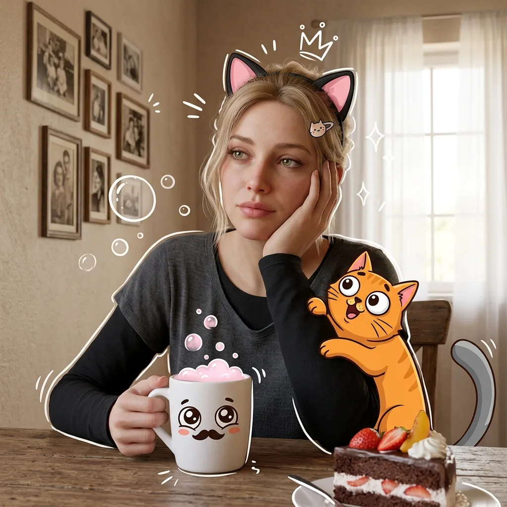

# Whimsical Cozy Portrait

[← Back to the collection](../../README.md) · Category: [Illustration & 3D](../../gallery/illustration-3d.md) · Model: `Vinano Image v2` · ID: `vn-00838`

<a href="https://vinano.ai?utm_source=github&utm_medium=readme&utm_campaign=awesome-image-video-prompts-updating&utm_content=prompt-page-image"></a>

<sub>Preview generated with <a href="https://vinano.ai?utm_source=github&utm_medium=readme&utm_campaign=awesome-image-video-prompts-updating&utm_content=prompt-page-caption">vinano.ai</a></sub>

## Prompt

```text
{
 "title": "Whimsical Cozy Portrait",
 "input_image": "[UPLOAD YOUR IMAGE]",
 "description": "Transform the uploaded image into a 64K DSLR-quality ultra-hyperrealistic cozy, whimsical mixed-media portrait combining realistic photography playful cartoon illustrations.",
 "subject": {
 "person": {
 "appearance": {
 "hair": "blonde, loosely tied soft strands framing the face",
 "eyes": "light green",
 "makeup": "natural",
 "top": "dark grey layered over black long-sleeve shirt",
 "expression": "resting cheek gently on one hand, dreamy and slightly tired",
 "accessories": ["black-and-pink cat ears",
 "small cute hair clip"]
 },
 "pose": "sitting at a wooden table, holding a white ceramic mug in one hand"
 },
 "animated_elements": [{
 "type": "cartoon_cat",
 "color": "bright orange",
 "expression": "excited, curious",
 "action": "climbing up her arm",
 "features": "exaggerated big eyes, expressive paws"
 },
 {
 "type": "cartoon_tail",
 "color": "grey",
 "position": "right side, partially out of frame"
 }]
 },
 "props": {
 "mug": {
 "color": "white",
 "illustration": "cute cartoon face big expressive eyes and small mustache",
 "drink": "pink foam bubbles rising from the top"
 },
 "dessert": {
 "type": "chocolate cake",
 "toppings": ["whipped cream", "sliced strawberries", "peach slice"]
 }
 },
 "environment": {
 "room": {
 "walls": "beige textured",
 "lighting": "soft daylight streaming through window sheer white curtains",
 "decor": "vintage framed photographs in casual gallery arrangement",
 "atmosphere": "warm, cozy, intimate"
 }
 },
 "illustration_effects": {
 "style": ["hand-drawn cartoon overlays",
 "white doodle-style accents: bubbles, playful lines, sparkles, hand-drawn crown",
 "soft white illustrated outlines around woman and objects"]
 },
 "composition": {
 "aspect_ratio": ["1:1", "4:5 vertical"],
 "depth_of_field": "shallow",
 "mood": ["cozy", "cute", "whimsical", "soft", "playful", "warm"]
 },
 "rendering": {
 "technique": ["Octane render", "Ultra-hyperrealistic", "Unreal Engine 5"],
 "details": "ultra-detailed, high-resolution, soft natural lighting, warm tones, Instagram-worthy",
 "texture_contrast": "realistic textures (skin, fabric, wood, wall) vs smooth vector-style illustrations"
 }
}

Emphasise material texture and natural light so the final frame feels tactile and premium.
```

## Try it on vinano.ai

1. Copy the prompt above.
2. Open **[vinano.ai](https://vinano.ai?utm_source=github&utm_medium=readme&utm_campaign=awesome-image-video-prompts-updating&utm_content=prompt-page-try)**, paste it into the image generator and pick a model.
3. Swap any placeholders (brand, product, city, person…) for your own details, then generate.

More prompts like this: [Illustration & 3D gallery](../../gallery/illustration-3d.md) · [all categories](../../README.md#contents)
